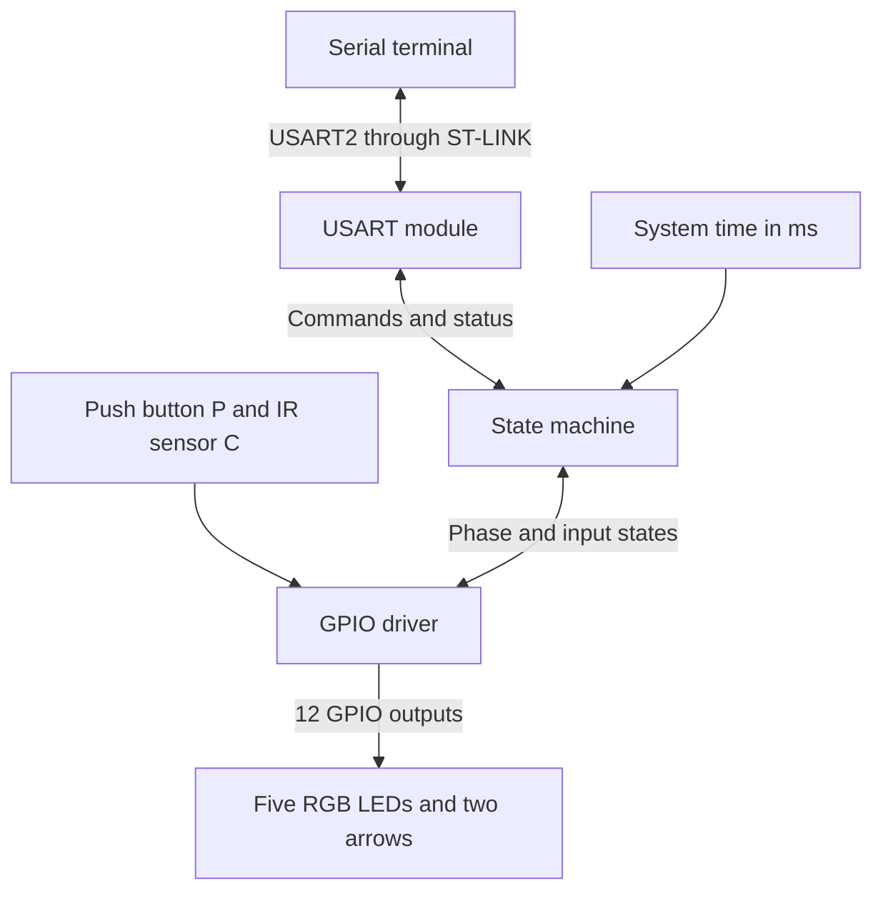
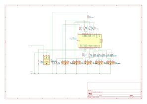

# T-junction traffic light model

Team project for the VRS course <sub>· traffic-fsm · model-gpio · usart-control</sub>

[Slovenčina](README.md) · **English**

The tag at the end of a paragraph refers to the branch listed under [team responsibilities](#team-responsibilities) and identifies who maintains the text. For shared sections, the listed owners agree on changes before opening a pull request. <sub>· traffic-fsm · model-gpio · usart-control</sub>

## Objective and demonstration

We will build a T-junction model with four vehicle signals, one pedestrian signal and two green arrows. The lights connect directly to 12 outputs on an STM32 NUCLEO-F303K8 board. Approach C has one lane shared by left- and right-turning vehicles and one IR sensor at the stop line. Pedestrians use a push button to request a green signal. <sub>· traffic-fsm · model-gpio</sub>

During the project demonstration, we will run the Demo cycle with approach C both clear and occupied. We will show that a signal continuing into the next phase stays green, that phase C starts after a car has waited 5 s, and measure the yellow and clearance intervals. In Control mode, we will operate the signals from a serial terminal and verify that the controller rejects a conflicting command. <sub>· traffic-fsm · model-gpio · usart-control</sub>

## Contents

<sub>traffic-fsm · model-gpio · usart-control</sub>

- [Project scope](#project-scope)
  - [Automatic control (DEMO)](#automatic-control-demo)
- [System overview](#system-overview)
- [Serial protocol](#serial-protocol)
- [Required hardware](#required-hardware)
  - [Wiring schematic](#wiring-schematic)
  - [LED wiring](#led-wiring)
- [Cost estimate](#cost-estimate)
- [Team responsibilities](#team-responsibilities)
- [Testing](#testing)
- [Learning objectives](#learning-objectives)
- [Repository workflow](#repository-workflow)

## Project scope

The main road runs from left to right in the layout. Approach B on the right has one lane for straight-ahead traffic and one for traffic turning onto the lower branch. The lower branch C has a shared approach lane for both turns and a separate exit lane for vehicles turning from A or B. We monitor whether the approach lane is occupied at the stop line on C. <sub>· traffic-fsm · model-gpio</sub>

<sub>traffic-fsm · model-gpio</sub>

| Signal | Approach | Movement permitted on green | Signal colours |
| --- | --- | --- | --- |
| `A` | From the left | Continue straight towards B or turn onto the lower branch towards C | Red, yellow, green |
| `A_S` | From the left | Turn onto the lower branch towards C while `A` is red | Green arrow |
| `B_R` | From the right | Continue straight along the main road towards A | Red, yellow, green |
| `B_D` | From the right | Turn onto the lower branch towards C | Red, yellow, green |
| `C` | Shared approach from below | Turn left from C towards A or right towards B | Red, yellow, green |
| `C_S` | Shared approach from below | Turn right from C towards B while `C` is red | Green arrow |
| `P` | Crossing on the lower branch | Cross the road | Red, green |


*Figure 1. Turning paths, the shared approach and separate exit lane on C, and the IR sensor at the stop line.* <sub>· model-gpio</sub>

### Signal rules

- At startup, all five signals show red and both arrows are off. The first green can begin after one second of all red. <sub>· traffic-fsm · model-gpio</sub>
- Each standard signal shows one colour at a time in a steady phase. A green on `A` or `C` permits both directions. Arrow `A_S` can light only while `A` is red, and arrow `C_S` only while `C` is red. <sub>· traffic-fsm</sub>
- A conflict matrix defines the permitted combinations. Two signals whose paths cross or merge into one lane never show green at the same time. <sub>· traffic-fsm · usart-control</sub>
- A signal that continues into the next phase stays green during the phase change. Ending standard signals turn yellow for 2 s, arrows turn off and P goes to red immediately. <sub>· traffic-fsm</sub>
- A new signal turns green only after it and every conflicting signal have been red for at least 1 s. An arrow can light right after the yellow on its own signal ends, because the same movement continues. <sub>· traffic-fsm</sub>

<sub>traffic-fsm</sub>

| | `A` | `A_S` | `B_R` | `B_D` | `C` | `C_S` | `P` |
| --- | :---: | :---: | :---: | :---: | :---: | :---: | :---: |
| **`A`** | | – | | ✕ | ✕ | ✕ | ✕ |
| **`A_S`** | – | | | ✕ | | | ✕ |
| **`B_R`** | | | | | ✕ | | |
| **`B_D`** | ✕ | ✕ | | | ✕ | | ✕ |
| **`C`** | ✕ | | ✕ | ✕ | | – | ✕ |
| **`C_S`** | ✕ | | | | – | | ✕ |
| **`P`** | ✕ | ✕ | | ✕ | ✕ | ✕ | |

*Conflict matrix. ✕ means the paths cross or merge into one lane according to Figure 1. – marks an arrow and its standard signal, which never light together.* <sub>· traffic-fsm</sub>

The turn from `A` onto the lower branch crosses the pedestrian crossing, and `A` has one signal for both directions. While pedestrians have green, only `B_R` can run, because it does not enter the lower branch. <sub>· traffic-fsm</sub>

### Pedestrian push button and detection on C

We will place the button beside crossing P. We will debounce the input so that one press registers one request, even when the button is held down. <sub>· model-gpio</sub>

The controller serves the request when P turns green. A press during the pedestrian green is covered by the current phase. A reset clears any pending request. <sub>· traffic-fsm</sub>

A car that only passes the sensor on C does not trigger phase C. The controller records request `C_REQ` only after a car has stood in front of the sensor for 5 s without interruption while `C` is not green. The request remains until `C` turns green. Only a car leaving while arrow `C_S` is lit cancels the request, that is, the sensor changing from occupied to clear while the arrow is on. The car has then turned right. If the car left before the arrow turned on and the sensor is already clear when it lights, the request remains and F2 is scheduled. <sub>· traffic-fsm</sub>

A single IR sensor at the stop line on C monitors the shared approach lane. We will check its detection range with a stationary car and with a car passing in the adjacent exit lane. <sub>· model-gpio</sub>

### Automatic control (DEMO)

In the table, **1** means green or an illuminated arrow. **0** means red or an arrow that is off. Yellow is used during the transition between phases. <sub>· traffic-fsm</sub>

<sub>traffic-fsm</sub>

| Phase | `A` | `A_S` | `B_R` | `B_D` | `C` | `C_S` | `P` |
| --- | ---: | ---: | ---: | ---: | ---: | ---: | ---: |
| F1 – Main road | 1 | 0 | 1 | 0 | 0 | 0 | 0 |
| F2 – Approach C (both directions) | 0 | 1 | 0 | 0 | 1 | 0 | 0 |
| F3 – B and right-turn arrow from C | 0 | 0 | 1 | 1 | 0 | 1 | 0 |
| F4 – Pedestrians and B straight | 0 | 0 | 1 | 0 | 0 | 0 | 1 |
| All red | 0 | 0 | 0 | 0 | 0 | 0 | 0 |

All red occurs only for 1 s after a reset and during a mode change. When the phase changes in Demo, a conflicting direction gets 2 s of yellow and at least 1 s of red before a conflicting signal turns green. A non-conflicting direction stays green, so all seven signals are never red together between phases. <sub>· traffic-fsm</sub>

The phases run in the order F1 → [F4] → [F2] → F3 → [F4] → F1. F4 is inserted when a pedestrian is waiting and F2 when `C_REQ` is set. Without requests, only F1 and F3 alternate. After startup and after returning to Demo, the controller starts with F1. <sub>· traffic-fsm</sub>

`B_R` is green in F1, F3 and F4, so it does not stop when the controller changes between them. With approach C clear, the main road from the right has a continuous green. Arrow `C_S` lights in every F3, so a car turning right from C can pass without stopping even if the sensor misses it. <sub>· traffic-fsm</sub>

In F2, vehicles from C turn left and right while arrow `A_S` lets a vehicle from A into the exit lane. In F3, `B_R` goes straight, `B_D` turns into the exit lane on C and `C_S` turns right onto the main road. We will use the paths in Figure 1 to test these movements with model cars. <sub>· traffic-fsm · model-gpio</sub>

For the model, we propose 5 s of green in every phase, 2 s of yellow and a 1 s clearance interval. A phase lasts 5 s from the moment all its signals are green. <sub>· traffic-fsm</sub>

<sub>traffic-fsm</sub>

| Time | Change with a car waiting on C | Phase |
| ---: | --- | --- |
| 1 s | `A` and `B_R` green | F1 |
| 6 s | `A` and `B_R` yellow | |
| 8 s | `A` and `B_R` red, `A_S` on | |
| 9 s | `C` green | F2 |
| 14 s | `C` yellow, `A_S` off | |
| 16 s | `C` red, `C_S` on | |
| 17 s | `B_R` and `B_D` green | F3 |
| 22 s | `B_D` yellow, `C_S` off, `B_R` continues | |
| 25 s | `A` green | F1 |

With approach C clear, the F1 → F3 cycle takes 16 s, and with a car on C it takes 24 s. The pedestrian phase F4 adds 6 s to the cycle while `B_R` stays green. If F2 follows F4, it adds 8 s, because `B_R` must go through yellow before `C` turns green. <sub>· traffic-fsm</sub>

The controller measures time using the system time in milliseconds. The main loop continues to read inputs and handle serial communication. Yellow and clearance intervals run for their full duration even if the preceding signal changes late. <sub>· traffic-fsm</sub>

### Control mode and mode changes

After entering Control mode, all signals are red and both arrows are off. The operator turns on individual signals, one arrow or both B signals together. The controller accepts a new green if it does not conflict with any lit signal and the clearance interval has elapsed. This way any Demo phase can be built step by step, as well as the combination of `A_S`, `B_R` and `C_S`. The green lasts until a valid command ends it or changes the mode. <sub>· traffic-fsm · usart-control</sub>

The controller continues to read the sensor and push button in Control mode. `STATUS` reports whether approach C is occupied and whether a pedestrian request is pending. `SET C GREEN` gives C a full green and `SET C_S GREEN` permits only the right turn. Turning P or C green serves the pedestrian or approach C request. <sub>· traffic-fsm · usart-control</sub>

When changing modes, the controller ends all lit signals according to the same rules. It lets any active vehicle yellow finish, turns off the arrows and sets P to red. The requested mode starts once all signals have been red for at least 1 s. If that time has already elapsed, the mode changes immediately. The controller retains pending pedestrian and approach C requests across the change. Returning to Demo starts with F1. <sub>· traffic-fsm</sub>

## System overview

<sub>traffic-fsm · model-gpio · usart-control</sub>



- **State machine.** It selects phases based on occupancy on C and pedestrian requests, measures intervals and checks commands from the terminal. It passes the requested phase to the GPIO driver. <sub>· traffic-fsm</sub>
- **GPIO driver.** It reads the push button and the IR sensor. It sets the red and green channels of each RGB signal and the state of both arrows for the current phase. <sub>· model-gpio</sub>
- **USART module.** It assembles incoming characters into lines, passes requests to the state machine and sends replies to the terminal. <sub>· usart-control</sub>

## Serial protocol

The computer connects through the ST-LINK virtual COM port. We will set USART2 and the terminal to **9600 baud**, 8 data bits, no parity, 1 stop bit and flow control disabled. The board connects PA2 to ST-LINK for TX and PA15 for RX. <sub>· usart-control</sub> [STMicroelectronics UM1956, Section 7.9](https://www.st.com/resource/en/user_manual/um1956-stm32-nucleo32-boards-mb1180-stmicroelectronics.pdf)

Commands use uppercase ASCII text with a single space between fields. The `<target>` parameter is `A`, `A_S`, `B_R`, `B_D`, `C`, `C_S` or `P`. Target `B` selects both signals on the right-hand approach. An incoming command has at most 32 characters before `LF`, `CRLF` or a single `CR`, which some terminals send when Enter is pressed. The device skips empty lines and sends one `CRLF`-terminated reply for each non-empty line. The terminal sends the next command after receiving the reply. <sub>· usart-control</sub>

<sub>traffic-fsm · usart-control</sub>

| Command | Behaviour |
| --- | --- |
| `MODE DEMO` | Requests a change to Demo. In steady Demo mode, the controller acknowledges the current state. |
| `MODE CONTROL` | Requests a change to Control. In steady Control mode, the controller acknowledges the current state. |
| `SET <target> GREEN` | Acknowledges the current state if all requested signals are already green. Otherwise turns the target signals green if they do not conflict with any lit signal and the clearance interval has elapsed. `A_S` and `C_S` light the arrow while the corresponding standard signal stays red. `B` turns both signals on the right green. Otherwise the controller returns `ERR CONFLICT`. |
| `SET <target> YELLOW` | If the target includes a standard vehicle signal that is green, ends the target's green signals. Standard signals turn yellow for 2 s. Other lit signals continue. |
| `SET <target> RED` | Ends the target's green signals. Vehicle green goes through yellow, an arrow turns off and P goes directly to red. Other lit signals continue. If the target shows yellow or red, or the target arrow is already off, the controller acknowledges the current state and continues the current timing. |
| `STATUS` | Reports the mode, mode change in progress, readiness, signal colours, arrow states, occupancy of approach C and a pending pedestrian request. |

The controller accepts `SET` commands in Control after any mode change has finished. `STATUS` is available during the change. Repeating a request for the same destination mode returns `OK` while the current transition continues. <sub>· traffic-fsm · usart-control</sub>

<sub>traffic-fsm · usart-control</sub>

| Reply | Meaning |
| --- | --- |
| `OK` | The controller accepted the command. `STATUS` shows the progress of a timed transition. |
| `ERR SYNTAX` | Unknown command, target, mode or colour, or an invalid line format. |
| `ERR LENGTH` | The line exceeded 32 characters. The receiver discards the rest of the line and then accepts the next command. |
| `ERR BUSY` | During a mode change, a `SET` command arrived or the operator requested a return to the mode being left. |
| `ERR MODE` | The operator sent `SET` in Demo mode. |
| `ERR STATE` | The yellow command targets no standard vehicle signal that is currently green. |
| `ERR CONFLICT` | The new green conflicts with a lit or yellow signal, or the clearance interval has not elapsed yet. |

Example `STATUS` reply in Control with a car at the stop line on C and a pending pedestrian request <sub>· usart-control</sub>

```text
OK MODE=CONTROL NEXT=- READY=1 A=RED A_S=OFF B_R=RED B_D=RED C=RED C_S=OFF P=RED CAR_C=1 P_REQ=1
```

`NEXT` shows the requested mode during a change and `-` at other times. `READY=1` means that in Control all signals have been red for at least 1 s and the controller accepts any green. The arrow states are reported as `ON` and `OFF`. `CAR_C=1` means the approach is occupied and `CAR_C=0` means it is clear. `P_REQ=1` indicates a pending pedestrian request. When P turns green, `P_REQ` becomes `0`. <sub>· traffic-fsm · usart-control</sub>

## Required hardware

<sub>model-gpio</sub>

| Item | Quantity | Use |
| --- | ---: | --- |
| STM32 NUCLEO-F303K8 | 1 | Control, programming and serial communication through ST-LINK |
| Diffused 5 mm common-cathode RGB LED | 5 | `A`, `B_R`, `B_D`, `C` and `P` |
| Green 5 mm LED | 2 | Arrows `A_S` and `C_S` |
| 330 Ω, ¼ W resistor | 12 | One for each red and green RGB channel and each green arrow |
| Normally open (NO) push button | 1 | Pedestrian request at crossing P |
| Reflective IR sensor with digital output and 3.3 V supply | 1 | Vehicle detection at the stop line on approach C |
| 830-point breadboard | 1 | Mounting the board and testing the wiring |
| Male-to-male jumper wires | 1 pack (40 pcs) | Breadboard connections |
| Computer and Micro-B USB data cable | 1 set | USB power, firmware flashing and the serial terminal through ST-LINK |

### Wiring schematic

<sub>model-gpio</sub>



The `TSSP58038` label and the push-button symbol in KiCad are illustrative. On approach C, we will use an available reflective IR module with a 3.3 V-compatible digital output. The schematic shows its three connections for the 3.3 V supply, GND and `OUT`. We will check the pin labels on the selected module and verify its output logic level during vehicle detection. <sub>· model-gpio</sub>

At crossing P, we will use an available normally open push button. We will wire its switch contacts so that pressing the button connects the input to ground. <sub>· model-gpio</sub>

### LED wiring

We will connect the common cathode of each RGB LED to GND. The red and green anodes will connect to separate GPIO outputs, each through its own series resistor. The blue pin stays disconnected. For a vehicle signal, lighting the red and green channels together produces yellow. The pedestrian signal uses red and green. <sub>· model-gpio</sub>

<sub>model-gpio</sub>

| Signal colour | Red channel R | Green channel G |
| --- | ---: | ---: |
| Red | 1 | 0 |
| Yellow (vehicle signals only) | 1 | 1 |
| Green | 0 | 1 |

We will use twelve identical 330 Ω series resistors. With one RGB LED connected to the board's 3.3 V outputs, we will first check the brightness of red and green and the resulting shade of yellow when both channels are on. The green channel has a higher forward voltage, so it may be dimmer with the same resistor value. <sub>· model-gpio</sub> [RGB LED specifications](https://techfun.sk/produkt/led-rgb-5-mm/) · [STM32F303x6/x8 datasheet, GPIO characteristics](https://www.st.com/resource/en/datasheet/stm32f303k8.pdf)

<sub>model-gpio</sub>

| Light | Board label | STM32 pin | Series resistor |
| --- | --- | --- | ---: |
| `A` R | A0 | PA0 | 330 Ω |
| `A` G | A1 | PA1 | 330 Ω |
| `B_R` R | A2 | PA3 | 330 Ω |
| `B_R` G | A3 | PA4 | 330 Ω |
| `B_D` R | A6 | PA7 | 330 Ω |
| `B_D` G | D9 | PA8 | 330 Ω |
| `C` R | D3 | PB0 | 330 Ω |
| `C` G | D6 | PB1 | 330 Ω |
| `P` R | D11 | PB5 | 330 Ω |
| `P` G | D12 | PB4 | 330 Ω |
| `A_S` green | D10 | PA11 | 330 Ω |
| `C_S` green | D13 | PB3 | 330 Ω |

With the default board configuration, the on-board user LED LD3 lights along with `C_S` because it is connected to D13. <sub>· model-gpio</sub>

In CubeMX, we will configure all 12 pins as `GPIO_Output`, `Push Pull` and `Low Speed`, with internal pull resistors disabled. The five red outputs (PA0, PA3, PA7, PB0, PB5) will start at `High`. The green outputs and arrows will start at `Low`. The `Serial Wire` debug setting leaves PB3 and PB4 available as GPIO. <sub>· model-gpio</sub>

The NUCLEO-F303K8 documentation specifies the board labels, the LD3 connection to D13 and the USB cable type. <sub>· model-gpio</sub> [STMicroelectronics UM1956, Sections 3.1 and 7.5, Table 12](https://www.st.com/resource/en/user_manual/um1956-stm32-nucleo32-boards-mb1180-stmicroelectronics.pdf)

## Cost estimate

The estimate assumes a single Techfun order. Prices include VAT and reflect offers checked on 16 November 2026. For items with multiple variants, we will check availability for the chosen variant when ordering. The sensor and push button in the table are examples of compatible parts. We count the NUCLEO board, computer and USB data cable as equipment for assembly and testing. <sub>· model-gpio</sub>

<sub>model-gpio</sub>

| Item | Quantity | Total price |
| --- | ---: | ---: |
| [Diffused 5 mm common-cathode RGB LED](https://techfun.sk/produkt/led-rgb-5-mm/) | 5 pcs | €0.75 |
| [5 mm LED, green variant](https://techfun.sk/produkt/led-ka-1-kus-5mm-rozne-farby/) | 2 pcs | €0.06 |
| [330 Ω, ¼ W resistors](https://techfun.sk/produkt/rezistor-rozne-hodnoty-1-4w-10-kusov/) | 1 pack (20 pcs) | €0.25 |
| [12 × 12 × 4.3 mm push button](https://techfun.sk/produkt/tlacidlo-1-kus-12x12x4-3-mm/) | 1 pc | €0.08 |
| [Reflective IR module with digital output and 3.3–5 V supply range](https://techfun.sk/produkt/infracerveny-senzor-pre-vyhybanie-sa-prekazkam/) | 1 pc | €0.65 |
| [830-point breadboard](https://techfun.sk/produkt/nepajive-pole-830-bodov/) | 1 pc | €1.60 |
| [10 cm male-to-male jumper wires](https://techfun.sk/produkt/kabliky-40-kusov-10-cm/) | 1 pack (40 pcs) | €1.45 |
| **Parts subtotal** | | **€4.84** |
| [GLS ParcelShop delivery](https://techfun.sk/sposob-platby-a-dorucenia/) | 1 shipment | €2.75 |
| **Total with delivery** | | **€7.59** |

If the signals sit farther from the breadboard, a pack of 20 cm jumper wires costs €2.20. With these wires, the order totals €8.34 including delivery. <sub>· model-gpio</sub> [20 cm jumper wires](https://techfun.sk/produkt/kabliky-40-kusov-20-cm/)

If we also need a data cable for the board, a 1 m USB-A to Micro-B cable is listed separately at €1.29 plus delivery. <sub>· model-gpio</sub> [Solight SSC1301E](https://www.solight.sk/solight-usb-kabel-usb-2-0-a-konektor--usb-b-micro-konektor-sacek-1m-detail-6021000201.aspx)

## Team responsibilities

Each team member will design, program and test their own module. They will submit its source files and the results of the three tests listed for their area. During the project demonstration, each member will show their work on the shared model. <sub>· traffic-fsm · model-gpio · usart-control</sub>

<sub>traffic-fsm · model-gpio · usart-control</sub>

| Member and branch | Design and implementation | Deliverable and demonstration |
| --- | --- | --- |
| **Branislav Krajčovič** · `feature/traffic-fsm` | Develop the state machine with a conflict matrix, phases F1–F4, carrying continuing signals across phase changes, and clearance intervals. Handle approach C and pedestrian requests and evaluate Control commands in the state machine. | Conflict matrix, transition table, state machine code and tests F1–F3. Demonstrate the continuous main-road green, phase C after a waiting car and the rejection of a conflicting request. |
| **Miroslav Kučera** · `feature/model-gpio` | Build the model and connect five RGB LEDs, two arrows, the push button and the IR sensor on C. Configure GPIO in CubeMX. Implement the output driver, initialisation and input handling. | Model, wiring schematic, GPIO driver and tests H1–H3. Demonstrate both arrows, the separate B signals and vehicle detection at the stop line on C. |
| **Samuel Jantošovič** · `feature/usart-control` | Design the protocol format and USART2 configuration. Implement reception and transmission, line assembly, syntax checking and reply formatting. Pass valid requests to the state machine. | Protocol description, serial communication code and tests U1–U3 with terminal logs. Demonstrate manual control and handling of an invalid command. |

## Testing

| Test | Procedure and expected result | Owner |
| --- | --- | --- |
| **F1 – Servicing approach C** | With the approach clear, verify F1 → F3 → F1, a continuous green on `B_R` and arrow `C_S` in every F3. A car that only passes the sensor does not trigger F2. A car waiting 5 s triggers F1 → F2 → F3 → F1, and `C_S` lights right after the yellow on `C`. A car that leaves while the arrow is lit after its request was recorded cancels the request. A car that leaves before the arrow turns on does not cancel it, and F2 follows the next F1. | <sub>traffic-fsm</sub> |
| **F2 – Arrows, conflicts and pedestrians** | Press the button during F1. After the yellow on `A` and the clearance second, P turns green together with `B_R` and all other signals are red. In Control with `B_D` green, send `SET A_S GREEN` and `SET P GREEN` and expect `ERR CONFLICT`. `SET C_S GREEN` is accepted and adds the arrow to `B_D`. | <sub>traffic-fsm</sub> |
| **F3 – Mode change** | During F3, press the button and request Control. Verify that `C_S` turns off, both B signals turn yellow, and all red follows. When `STATUS` shows `MODE=CONTROL` and `READY=1`, check `P_REQ=1` and turn P green. Request Demo while P is green. F1 should start after the one-second clearance interval. | <sub>traffic-fsm</sub> |
| **H1 – LED mapping** | On the workbench, turn on each of the 12 outputs individually. Verify the channels and arrows. For each vehicle signal, turn on R and G together and check that yellow is distinguishable from red and green. | <sub>model-gpio</sub> |
| **H2 – Initialisation and transition** | Reset the board during an active phase and check that all five signals first light red for 1 s. Verify all red on every signal after a reset and when switching from Demo to Control. On F1 → F3 (approach C clear), verify 2 s of yellow and 1 s of red on `A` before `B_D` and `C_S` turn on, while `B_R` stays green throughout. On F1 → F2 (car on C), verify that `A_S` lights right after the yellow on `A`, and `C` only 1 s after `A` and `B_R` turn red. | <sub>model-gpio · traffic-fsm</sub> |
| **H3 – Reading inputs** | Put a car at the stop line on C. Verify `CAR_C=1` while it is stopped and `CAR_C=0` after it leaves. A car passing in the exit lane should leave `CAR_C=0`. Holding the button should register a single press, with another press registered after release and a new press. | <sub>model-gpio</sub> |
| **U1 – Control and status** | When `READY=1`, try `SET B_R GREEN`, `SET B_D GREEN`, `SET C GREEN` and `SET C_S GREEN`. Before requesting each new green, end the previous phase and wait for `READY=1`. Send `STATUS` with both `LF` and `CRLF` and verify `CAR_C` and `P_REQ`. | <sub>usart-control</sub> |
| **U2 – Invalid command and receiver recovery** | In steady Control mode, send `SET X GREEN`, `SET A_S YELLOW` and a 33-character line. Expect `ERR SYNTAX`, `ERR STATE` and `ERR LENGTH`. Check that the following `STATUS` command is processed normally. | <sub>usart-control</sub> |
| **U3 – Commands during operation** | In Demo, send `SET A RED` and expect `ERR MODE`. During green, send `MODE CONTROL`. Immediately after `OK`, send `SET P GREEN` and expect `ERR BUSY` while the mode is changing. | <sub>usart-control</sub> |

### Integrated test on the assembled model

1. After a reset, check all red and the F1 → F3 cycle with approach C clear, during which `B_R` stays green. Place a car at the stop line on C; after 5 s of waiting, F2 is scheduled. Guide the model cars along the marked permitted paths and check the clearance between them. Use video to measure the green and yellow intervals and the clearance time before a conflicting direction turns green. <sub>· traffic-fsm · model-gpio</sub>
2. During F3, press the button. P turns green after `C_S` goes off, `B_D` turns yellow and the clearance second ends. Verify that `B_R` stays green, the other signals are red, both arrows are off, and the controller continues with F1 after P. <sub>· traffic-fsm · model-gpio</sub>
3. In Control with `READY=1`, send `SET A_S GREEN`. A should show red with the arrow on. `SET B_D GREEN` should return `ERR CONFLICT`. Send `SET A_S RED`, wait for the all-red clearance interval to end, then repeat the command for `B_D` and check `OK` and the signal on the model. <sub>· traffic-fsm · usart-control</sub>

We will include the measured intervals and a terminal log of commands and replies in the evaluation. <sub>· traffic-fsm · model-gpio · usart-control</sub>

## Learning objectives

- Configure GPIO in STM32CubeMX, read an IR sensor and debounce a push button. <sub>· model-gpio</sub>
- Wire common-cathode RGB LEDs and verify the output mapping by checking the displayed colours. <sub>· model-gpio</sub>
- Design a state machine with non-blocking timing and test the permitted transitions. <sub>· traffic-fsm</sub>
- Exchange commands and replies through USART and verify that communication does not disrupt phase timing. <sub>· usart-control</sub>
- Define interfaces between C modules and verify their integration on the shared model. <sub>· traffic-fsm · model-gpio · usart-control</sub>

## Repository workflow

1. We keep the shared project version on `main`. Miroslav prepares changes to the `.ioc` configuration and GPIO mapping after discussing them with Branislav and Samuel. <sub>· traffic-fsm · model-gpio · usart-control</sub>
2. Each member develops and tests their module on their own branch. A teammate reviews each pull request before it is merged into `main`. <sub>· traffic-fsm · model-gpio · usart-control</sub>
3. After merging the modules, we verify their integration in the [integrated test on the assembled model](#integrated-test-on-the-assembled-model). <sub>· traffic-fsm · model-gpio · usart-control</sub>
4. Before the project demonstration, we build the firmware from `main`, flash it through ST-LINK and run the tests on the assembled model. We save the results with the wiring map and a sample terminal session. <sub>· traffic-fsm · model-gpio · usart-control</sub>
