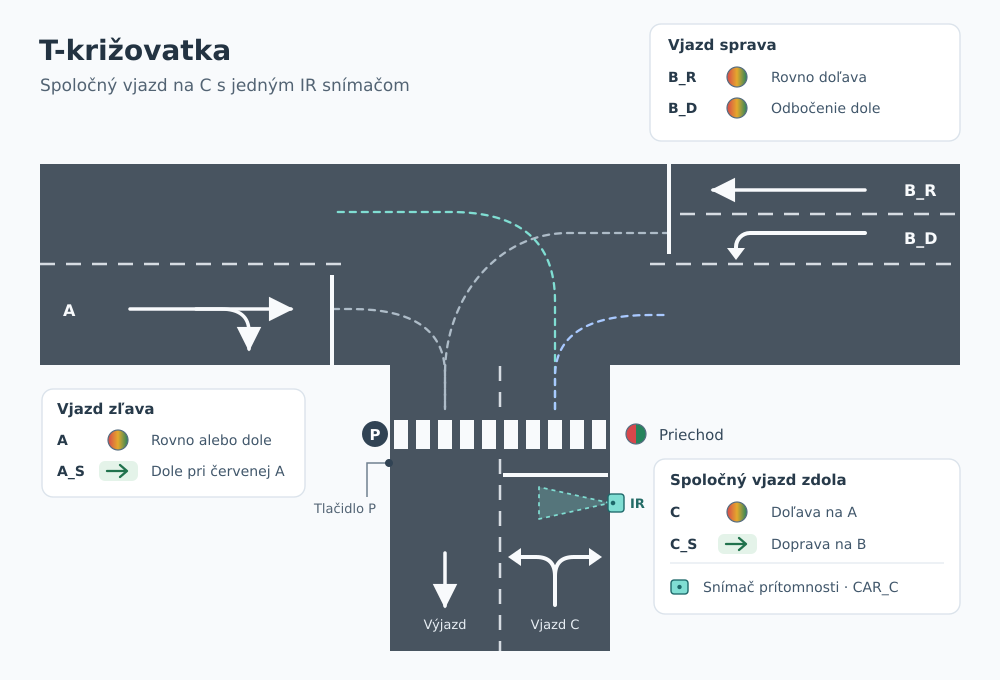
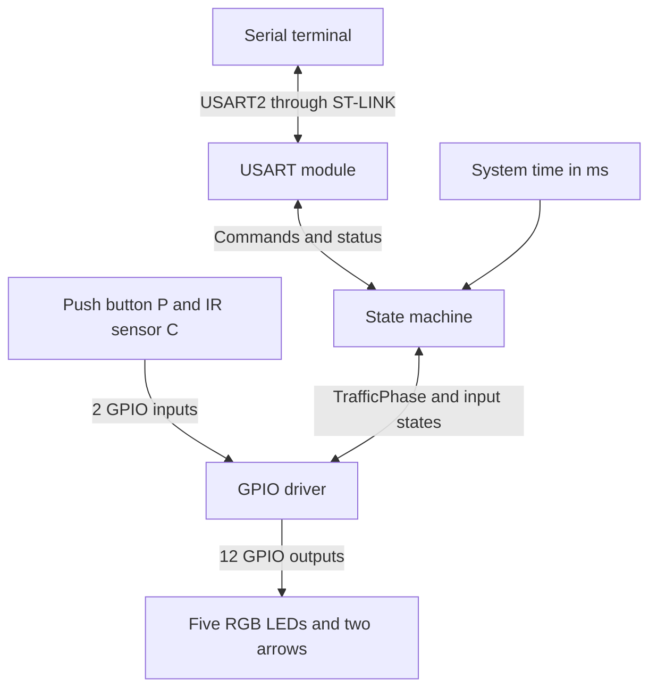
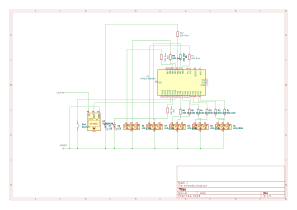

# T-junction traffic light model

Team project for the VRS course <sub>· traffic-fsm · model-gpio · usart-control</sub>

[Slovenčina](README.md) · **English**

The label beside a paragraph refers to the branch in [team responsibilities](#team-responsibilities) and identifies who edits and maintains the text. When a section has several owners, they agree on the change before opening a pull request. <sub>· traffic-fsm · model-gpio · usart-control</sub>

## Objective and demonstration

We will build a T-junction model with four vehicle signals, one pedestrian signal and two green arrows. The lights connect directly to 12 outputs on an STM32 NUCLEO-F303K8 board. Approach C has one lane shared by left- and right-turning vehicles and one IR sensor at the stop line. Pedestrians use a push button to request a green signal. <sub>· traffic-fsm · model-gpio</sub>

During the demonstration, we will run the Demo cycle with approach C both clear and occupied. We will show which movements can run together when vehicles turn from C and measure the yellow and all-red intervals. In Control mode, we will operate the signals from a serial terminal and verify that the controller rejects a conflicting request. <sub>· traffic-fsm · model-gpio · usart-control</sub>

## Contents

<sub>traffic-fsm · model-gpio · usart-control</sub>

- [Project scope](#project-scope)
- [System overview](#system-overview)
- [Serial protocol](#serial-protocol)
- [Required hardware](#required-hardware)
  - [Wiring schematic](#wiring-schematic)
- [Cost estimate](#cost-estimate)
- [Team responsibilities](#team-responsibilities)
- [Testing](#testing)
- [Learning objectives](#learning-objectives)
- [Repository workflow](#repository-workflow)

## Project scope

The main road runs from left to right in the layout. Approach B on the right has one lane for straight-ahead traffic and one for turning onto the lower branch. The lower branch C has a shared approach lane for both turns and a separate exit lane for vehicles turning from A or B. The IR sensor monitors the approach lane at the stop line. <sub>· traffic-fsm · model-gpio</sub>

<sub>traffic-fsm · model-gpio</sub>

| Signal | Approach | Movement permitted on green | Signal colours |
| --- | --- | --- | --- |
| `A` | From the left | Continue straight towards B or turn onto the lower branch towards C | Red, yellow, green |
| `A_S` | From the left | Turn onto the lower branch towards C while `A` is red | Green arrow |
| `B_R` | From the right | Continue straight along the main road towards A | Red, yellow, green |
| `B_D` | From the right | Turn onto the lower branch towards C | Red, yellow, green |
| `C` | Shared approach from below | Turn left from C towards A | Red, yellow, green |
| `C_S` | Shared approach from below | Turn right from C towards B while `C` is red | Green arrow |
| `P` | Crossing on the lower branch | Cross the road | Red, green |



*Figure 1 – Turning paths, the shared approach and separate exit lane on C, and the IR sensor at the stop line.* <sub>· model-gpio</sub>

### Signal rules

- At startup, all five signals show red and both arrows are off. The first green can begin after one second of all red. <sub>· traffic-fsm · model-gpio</sub>
- Each standard signal shows one colour at a time in a steady phase. Arrow `A_S` can light only while `A` is red. A right turn from C requires arrow `C_S` and a red `C` signal. A pedestrian green requires red on all four vehicle signals and both arrows off. <sub>· traffic-fsm</sub>
- The controller uses the vehicle combinations in the Demo table and the selections described in the Control commands. For example, `A_S` and `B_D` both lead into the same exit lane, so they run in separate phases. <sub>· traffic-fsm · usart-control</sub>
- At the end of a phase, the arrows turn off and all standard vehicle signals that were green switch to yellow together for 2 s. A phase with only an arrow or the pedestrian signal goes directly to all red. The controller holds all red for at least 1 s before another green. <sub>· traffic-fsm</sub>

### Pedestrian push button

We will place the button beside crossing P. An input change is accepted after the signal has stayed stable for 30 ms. <sub>· model-gpio</sub>

Holding the button registers one request. The request is served when P turns green. A press during the pedestrian green is covered by that phase. A reset clears any pending request. <sub>· traffic-fsm</sub>

### Demo mode

When `A` is green, a vehicle can turn from A onto C across the pedestrian crossing. Pedestrians therefore get a separate green phase with all vehicle signals red and both arrows off. <sub>· traffic-fsm</sub>

In the table, **1** means green or an illuminated arrow. **0** means red or an arrow that is off. Yellow is used during the transition between phases. <sub>· traffic-fsm</sub>

<sub>traffic-fsm</sub>

| Phase | `A` | `A_S` | `B_R` | `B_D` | `C` | `C_S` | `P` |
| --- | ---: | ---: | ---: | ---: | ---: | ---: | ---: |
| A | 1 | 0 | 1 | 0 | 0 | 0 | 0 |
| Left turn from C | 0 | 1 | 0 | 0 | 1 | 0 | 0 |
| B with a right turn from C | 0 | 0 | 1 | 1 | 0 | 1 | 0 |
| B with approach C clear | 0 | 0 | 1 | 1 | 0 | 0 | 0 |
| Pedestrians | 0 | 0 | 0 | 0 | 0 | 0 | 1 |
| All red | 0 | 0 | 0 | 0 | 0 | 0 | 0 |

The cycle starts with phase A after the startup all-red interval. At the end of phase A and its all-red interval, the controller reads the filtered `CAR_C` input. <sub>· traffic-fsm</sub>

- With `CAR_C=0`, the controller runs B with approach C clear and then returns to A. <sub>· traffic-fsm</sub>
- With `CAR_C=1`, the controller runs the left turn from C, then B with a right turn from C, and then returns to A. The single sensor detects whether the approach lane is occupied, so the cycle allocates time to both turns. The right-turn phase still runs if the lane clears during the left-turn phase. The controller checks occupancy again after the next phase A. <sub>· traffic-fsm</sub>

During the left-turn phase, a vehicle from C joins the lane towards A. Arrow `A_S` also permits a vehicle from A to turn into the separate exit lane on the lower branch. In the B phase with a right turn from C, `B_R` permits straight-ahead traffic towards A, `B_D` permits traffic into the exit lane on C, and `C_S` permits a right turn onto the main road towards B. We will use the paths in Figure 1 to test these movements with model cars. <sub>· traffic-fsm · model-gpio</sub>

The green interval of a vehicle phase lasts 5 s. When it ends, the arrows turn off immediately and the green vehicle signals switch to yellow for 2 s. This is followed by at least 1 s of all red. If a pedestrian request is pending, the controller inserts phase P after the vehicle phase and its clearance interval. P stays green for 5 s, followed by all red and then the vehicle phase that was already scheduled. <sub>· traffic-fsm</sub>

The controller measures elapsed time from the start of each phase using the system time in milliseconds. The main loop continues to read inputs and handle serial communication. The yellow and all-red intervals retain their full duration if the preceding phase ends late. <sub>· traffic-fsm</sub>

### Control mode and mode changes

In Control mode, the controller waits at all red. The operator can select a standard signal, an arrow or P. One command can also turn both B signals green. The green lasts until a valid command ends the phase or changes the mode. A new selection can take effect after the clearance interval. <sub>· traffic-fsm · usart-control</sub>

The controller continues to read the sensor and push button in Control mode. `STATUS` reports whether approach C is occupied and whether a pedestrian request is pending. Use `SET C GREEN` for a left turn from C and `SET C_S GREEN` for a right turn. `SET P GREEN` turns P green and serves the pedestrian request. <sub>· traffic-fsm · usart-control</sub>

The controller ends the active phase according to the same rules when changing modes. It lets any active yellow interval finish, turns off the arrows and sets P to red. The requested mode starts after the all-red interval. If that interval has already elapsed, the mode changes immediately. A pending pedestrian request is retained across the change. Returning to Demo starts the cycle at phase A. <sub>· traffic-fsm</sub>

## System overview

<sub>traffic-fsm · model-gpio · usart-control</sub>



- The **state machine** selects phases based on occupancy at C and pedestrian requests, times the intervals and validates terminal commands. It passes the complete phase to the GPIO driver as a `TrafficPhase`. <sub>· traffic-fsm</sub>
- The **GPIO driver** reads and filters the push button and IR sensor. It sets the red and green channels of each RGB signal and controls both arrows according to the phase. <sub>· model-gpio</sub>
- The **USART module** receives bytes in an interrupt and assembles lines in the main loop. It passes requests to the state machine and reports signal colours, arrow states, occupancy and the pending pedestrian request. Reception and transmission are non-blocking in the main loop. <sub>· usart-control</sub>

## Serial protocol

The computer connects through the ST-LINK Virtual COM port. We will use **USART2 at 9600 baud, 8 data bits, no parity, 1 stop bit and no flow control**. PA2 is TX and PA15 is RX. <sub>· usart-control</sub> [STMicroelectronics UM1956, section 7.9](https://www.st.com/resource/en/user_manual/um1956-stm32-nucleo32-boards-mb1180-stmicroelectronics.pdf)

Commands use uppercase ASCII with one space between fields. The `<target>` parameter can be `A`, `A_S`, `B_R`, `B_D`, `C`, `C_S` or `P`. Target `B` selects both signals on the right-hand approach. An input line can contain up to 32 characters before its `LF` or `CRLF` terminator. The device skips empty lines and sends one `CRLF`-terminated response for each non-empty line. The terminal sends the next command after receiving the response. <sub>· usart-control</sub>

<sub>traffic-fsm · usart-control</sub>

| Command | Behaviour |
| --- | --- |
| `MODE DEMO` | Requests Demo mode. If Demo is already active and stable, acknowledges the current state. |
| `MODE CONTROL` | Requests Control mode. If Control is already active and stable, acknowledges the current state. |
| `SET <target> GREEN` | Enables the selected green when `READY=1`. For `A_S` and `C_S`, the arrow lights while its standard signal stays red. For `B`, both B signals turn green. If all requested signals are already green, acknowledges their current state. A different active phase or a clearance interval returns `ERR CONFLICT`. |
| `SET <target> YELLOW` | Ends the current green phase if the target includes a standard vehicle signal that is currently green. All standard vehicle signals that were green in that phase show yellow for 2 s. |
| `SET <target> RED` | Ends the entire active phase if the target includes a signal that is currently green. Vehicle signals go through yellow, arrows turn off, and P switches directly to red. If the target shows yellow or red or its arrow is off, acknowledges the current state and leaves the timing intact. |
| `STATUS` | Returns the mode, mode transition, readiness, signal colours, arrow states, occupancy at C and the pending pedestrian request. |

The controller executes `SET` commands in Control mode after any mode transition is complete. `STATUS` is available during transitions. Repeating a request for the same pending mode returns `OK` and the timing continues. <sub>· traffic-fsm · usart-control</sub>

<sub>traffic-fsm · usart-control</sub>

| Response | Meaning |
| --- | --- |
| `OK` | The command was accepted. `STATUS` reports progress through the timed transition. |
| `ERR SYNTAX` | Unknown command, target, mode or colour, or an invalid line format. |
| `ERR LENGTH` | The input line exceeded 32 characters. The receiver discards the remainder up to the line terminator and then accepts the next command. |
| `ERR BUSY` | A `SET` command or a request to return to the mode being left arrived during a mode transition. |
| `ERR MODE` | A `SET` command was sent in Demo mode. |
| `ERR STATE` | The request for yellow did not target any standard vehicle signal that was green. |
| `ERR CONFLICT` | A new green was requested during an active phase, the yellow interval or the all-red interval. |

Example `STATUS` response in Control mode with a car at the stop line on C and a pending pedestrian request <sub>· usart-control</sub>

```text
OK MODE=CONTROL NEXT=- READY=1 A=RED A_S=OFF B_R=RED B_D=RED C=RED C_S=OFF P=RED CAR_C=1 P_REQ=1
```

`NEXT` gives the requested mode during a transition and `-` otherwise. `READY=1` means Control can accept a new green phase. Arrows are reported as `ON` or `OFF`. `CAR_C=1` means the approach is occupied and `CAR_C=0` means it is clear. `P_REQ=1` marks a pending pedestrian request. It returns to `0` when P turns green. <sub>· traffic-fsm · usart-control</sub>

## Required hardware

<sub>model-gpio</sub>

| Item | Quantity | Purpose |
| --- | ---: | --- |
| STM32 NUCLEO-F303K8 | 1 | Controller, programming and serial communication through ST-LINK |
| 5 mm diffused common-cathode RGB LED | 5 | Signals `A`, `B_R`, `B_D`, `C` and `P` |
| 5 mm green LED | 2 | Arrows `A_S` and `C_S` |
| 330 Ω, ¼ W resistor | 12 | One per red and green RGB LED channel and one per green arrow |
| Normally open push button | 1 | Request at crossing P |
| Reflective IR module with an LM393 and digital output (FC-51 type) | 1 | Detects a car waiting at the stop line on C |
| 830-point breadboard | 1 | Mounting the board and prototyping the circuit |
| Male-to-male jumper wires | 1 pack of 40 | Breadboard wiring |
| Three-wire male-to-female lead | 1 | Connects the roadside sensor to the breadboard |
| Model car or mock-up | 2–3 | Tests for detection and simultaneous movements |
| Base and model materials | 1 set | Road, crossing and mounts for the signals and sensor |
| Computer and Mini-B USB data cable | 1 set | USB power, firmware upload and serial terminal |

### Wiring schematic

<sub>model-gpio</sub>



The KiCad draft uses the STM32F303K8Tx microcontroller symbol, twelve 330 Ω resistors and the TSSP58038 IR receiver symbol. The NUCLEO-F303K8 prototype will use the FC-51 module wired as shown in the input pin table below. <sub>· model-gpio</sub>

### LED wiring

Connect the common cathode of each RGB LED to GND. Connect the red and green anodes to separate GPIO outputs, each through its own resistor. Leave the blue lead disconnected. Vehicle signals produce yellow by turning on both the red and green channels. The pedestrian signal uses red and green. <sub>· model-gpio</sub>

<sub>model-gpio</sub>

| Signal colour | Red channel R | Green channel G |
| --- | ---: | ---: |
| Red | 1 | 0 |
| Yellow (vehicle signals only) | 1 | 1 |
| Green | 0 | 1 |

We will use twelve identical 330 Ω series resistors. We will test one RGB LED on the board's 3.3 V outputs first. We will check the brightness of red and green and the shade of yellow when both channels are on. The green channel has a higher forward voltage, so it may be dimmer with the same resistance. <sub>· model-gpio</sub> [RGB LED specifications](https://techfun.sk/produkt/led-rgb-5-mm/) · [STM32F303x6/x8 datasheet, GPIO characteristics](https://www.st.com/resource/en/datasheet/stm32f303k8.pdf)

<sub>model-gpio</sub>

| Light | Board label | STM32 pin | Connector | Series resistor |
| --- | --- | --- | --- | ---: |
| `A` R | A0 | PA0 | CN4/12 | 330 Ω |
| `A` G | A1 | PA1 | CN4/11 | 330 Ω |
| `B_R` R | A2 | PA3 | CN4/10 | 330 Ω |
| `B_R` G | A3 | PA4 | CN4/9 | 330 Ω |
| `B_D` R | A6 | PA7 | CN4/6 | 330 Ω |
| `B_D` G | D9 | PA8 | CN3/12 | 330 Ω |
| `C` R | D3 | PB0 | CN3/6 | 330 Ω |
| `C` G | D6 | PB1 | CN3/9 | 330 Ω |
| `P` R | D11 | PB5 | CN3/14 | 330 Ω |
| `P` G | D12 | PB4 | CN3/15 | 330 Ω |
| `A_S` green | D10 | PA11 | CN3/13 | 330 Ω |
| `C_S` green | D13 | PB3 | CN4/15 | 330 Ω |

The on-board user LED LD3 also lights when `C_S` turns on because both use D13. <sub>· model-gpio</sub> [STMicroelectronics UM1956, sections 6.4 and 7.11](https://www.st.com/resource/en/user_manual/um1956-stm32-nucleo32-boards-mb1180-stmicroelectronics.pdf)

### Push button and IR sensor wiring

Connect the push button between `P_BTN` and GND. Mount the reflective IR module beside approach C so that it detects a car just before the stop line. Use the potentiometer to set the detection range for one lane. Check that the sensor detects a waiting car and that traffic in the adjacent exit lane leaves the input in its clear state. <sub>· model-gpio</sub> [IR module specifications](https://techfun.sk/produkt/infracerveny-senzor-pre-vyhybanie-sa-prekazkam/)

Connect the module's `VCC` to `+3V3` (CN4/14), `GND` to common ground and `OUT` to D2. We expect `OUT` to go low when a car is detected. After 30 ms at a stable level, the driver reports `CAR_C=1` for an occupied lane or `CAR_C=0` for a clear lane. During setup, we will verify the polarity and range with the cars used on the model. <sub>· model-gpio</sub> [FC-51 wiring and polarity](https://flashready.in/components/ir-obstacle-sensor)

<sub>model-gpio</sub>

| Input | Board label | STM32 pin | Connector | CubeMX setting |
| --- | --- | --- | --- | --- |
| Push button `P_BTN` | D0 | PA10 | CN3/2 | `GPIO_Input`, pull-up |
| Sensor `OUT` for `CAR_C` | D2 | PA12 | CN3/5 | `GPIO_Input`, pull-up |

Pin D1 (PA9) is available. <sub>· model-gpio</sub>

In CubeMX, configure all 12 outputs as `GPIO_Output` with `Push Pull`, `Low Speed` and `No pull-up and no pull-down`. Set the initial level of the five red outputs to `High` and the green outputs and arrows to `Low`. The two colour channels of each signal are on the same GPIO port and can be set with a single `BSRR` write. Use `Serial Wire` for debugging so that PB3 and PB4 are available as GPIOs. USART2 uses PA2 and PA15. <sub>· model-gpio · usart-control</sub> [STMicroelectronics UM1956, Table 12](https://www.st.com/resource/en/user_manual/um1956-stm32-nucleo32-boards-mb1180-stmicroelectronics.pdf)

## Cost estimate

The estimate uses Techfun prices as of 12 November 2026, including VAT. It covers parts for one model, excluding the NUCLEO board, model cars and materials for the model. <sub>· model-gpio</sub>

<sub>model-gpio</sub>

| Item | Order quantity | Total price |
| --- | ---: | ---: |
| [5 mm diffused common-cathode RGB LED](https://techfun.sk/produkt/led-rgb-5-mm/) | 5 | €0.75 |
| [5 mm green LED](https://techfun.sk/produkt/led-ka-1-kus-5mm-rozne-farby/) | 2 | €0.06 |
| [330 Ω, ¼ W resistors](https://techfun.sk/produkt/rezistor-rozne-hodnoty-1-4w-10-kusov/) | 1 pack (20 pieces) | €0.25 |
| [Push button with cap](https://techfun.sk/produkt/tlacidlo-s-nasadou/) | 1 | €0.15 |
| [Reflective IR module with LM393](https://techfun.sk/produkt/infracerveny-senzor-pre-vyhybanie-sa-prekazkam/) | 1 | €0.65 |
| [830-point breadboard](https://techfun.sk/produkt/nepajive-pole-830-bodov/) | 1 | €1.60 |
| [20 cm male-to-male jumper wires](https://techfun.sk/produkt/kabliky-40-kusov-20-cm/) | 1 pack of 40 | €2.20 |
| [Three-pin male-to-female sensor lead](https://techfun.sk/produkt/kablik-70cm-2piny-3piny-4piny/) | 1 | up to €0.85 |
| **Parts subtotal** | | **up to €6.51** |
| [GLS ParcelShop delivery](https://techfun.sk/sposob-platby-a-dorucenia/) | 1 shipment | €2.75 |
| **Total with delivery** | | **up to €9.26** |

The estimate uses the upper end of the published price range for the sensor lead. If we already have three male-to-female jumpers for the sensor, the total including delivery is €8.41. A Mini-B USB data cable costs from €0.70, depending on its length. <sub>· model-gpio</sub> [USB cable listing](https://techfun.sk/produkt/usb-na-mini-usb-kabel-rozne-dlzky/)

## Team responsibilities

Each member will design, implement and test one module. They will submit the source files and the results of the three tests assigned to their module, then demonstrate their work on the assembled model. <sub>· traffic-fsm · model-gpio · usart-control</sub>

<sub>traffic-fsm · model-gpio · usart-control</sub>

| Member and branch | Design and implementation | Deliverable and demonstration |
| --- | --- | --- |
| **Branislav Krajčovič** · `feature/traffic-fsm` | Implement the phase combinations in `traffic_fsm.c/.h`, schedule both turns when C is occupied, end green phases and time the clearance intervals. Handle pedestrian requests and Control commands. | State transition table, state machine code and tests F1–F3. Demonstrate both sets of simultaneous movements for turns from C and the rejection of a conflicting request. |
| **Miroslav Kučera** · `feature/model-gpio` | Build the model and wire five RGB LEDs, two arrows, the push button and the IR sensor at C. Configure the GPIOs in CubeMX. Implement colour mapping, GPIO control, initialisation and input filtering in `traffic_gpio.c/.h`. | Model, wiring diagram, driver code and tests H1–H3. Demonstrate both arrows, the separate B signals and detection of a car at the stop line on C. |
| **Samuel Jantošovič** · `feature/usart-control` | Design the protocol and configure USART2. Implement interrupt-driven reception and transmission, line assembly, target validation and status reporting in `traffic_serial.c/.h`. | Protocol description, communication code and tests U1–U3 with a terminal log. Demonstrate manual control and handling of invalid input. |

## Testing

| Test | Procedure and expected result | Owner |
| --- | --- | --- |
| **F1 – Handling traffic from C** | With C clear, verify A → B → A. With a car at the stop line, verify A → left turn from C → B with a right turn from C → A. Remove the car during the left-turn phase and check that the scheduled phase with `C_S` still runs. | <sub>traffic-fsm</sub> |
| **F2 – Arrows, conflicts and pedestrians** | Verify `C` with `A_S` and `B_R`, `B_D` and `C_S` together. Press the button while A is green. P should turn green after yellow and all red, with all vehicle movements blocked. In Control mode, send `SET A_S GREEN` while `B_D` is green and expect `ERR CONFLICT`. | <sub>traffic-fsm</sub> |
| **F3 – Mode change** | During B with a right turn from C, press the button and switch to Control. Check that `C_S` goes off, both B signals go yellow, and all red follows. Check for `P_REQ=1` in the status. Turn P green and request Demo during the pedestrian phase. Phase A should start after the one-second clearance interval. | <sub>traffic-fsm</sub> |
| **H1 – LED mapping** | On the bench, enable the 12 outputs one at a time and check the channel and arrow mapping. Turn on R and G together for each vehicle signal and check that yellow is visibly distinct from red and green. | <sub>model-gpio</sub> |
| **H2 – Initialisation and transitions** | Reset the board during an active phase and check that the first illuminated state is all five signals red. Check for yellow and all red before the next green when the phase changes. | <sub>model-gpio</sub> |
| **H3 – Reading the inputs** | Place a car before the stop line on C. Check for `CAR_C=1` while it waits and `CAR_C=0` after it leaves. A car passing through the exit lane should leave `CAR_C=0`. Holding the button should register one press. A new press is registered after release. | <sub>model-gpio</sub> |
| **U1 – Manual control and status** | When `READY=1`, try `SET B_R GREEN`, `SET B_D GREEN`, `SET C GREEN` and `SET C_S GREEN`. End each previous phase and wait for `READY=1` before selecting the next one. Send `STATUS` with both `LF` and `CRLF` and check `CAR_C` and `P_REQ`. | <sub>usart-control</sub> |
| **U2 – Invalid input and recovery** | In Control mode, send `SET X GREEN`, `SET A_S YELLOW` and a 33-character line. Expect `ERR SYNTAX`, `ERR STATE` and `ERR LENGTH`, respectively. The following `STATUS` should be processed normally. | <sub>usart-control</sub> |
| **U3 – Commands during operation** | In Demo mode, send `SET A RED` and check for `ERR MODE`. While a signal is green, send `MODE CONTROL` and then `SET P GREEN` immediately after `OK`. The latter should return `ERR BUSY` during the transition. | <sub>usart-control</sub> |

### Integrated test on the assembled model

1. Reset the controller and check all red, followed by the A → B cycle with C clear. Place a car on C to trigger both phases with turns from C. Move the cars along the marked paths and check the clearance between them. Use video to measure the green, yellow and all-red intervals. <sub>· traffic-fsm · model-gpio</sub>
2. Press the button during B with a right turn from C. Check that `C_S` goes off, both B signals show yellow and all red follows before P turns green. Verify that every vehicle signal is red and both arrows are off while P is green. Check that phase A follows the pedestrian phase and its clearance interval. <sub>· traffic-fsm · model-gpio</sub>
3. In Control mode, wait for `READY=1` and send `SET A_S GREEN`. Check for a red signal at A alongside the green arrow. `SET B_D GREEN` must return `ERR CONFLICT`. Send `SET A_S RED`, wait for the all-red interval to end, and repeat the command for `B_D`. Check for `OK` and the corresponding signal on the model. <sub>· traffic-fsm · usart-control</sub>

We will include the measured intervals and a terminal log of the commands and responses with the test results. <sub>· traffic-fsm · model-gpio · usart-control</sub>

## Learning objectives

- Configure GPIOs in STM32CubeMX, read an IR sensor and debounce a push button. <sub>· model-gpio</sub>
- Wire common-cathode RGB LEDs and verify the output mapping by checking the resulting colours. <sub>· model-gpio</sub>
- Design a state machine with non-blocking timing and test the allowed transitions. <sub>· traffic-fsm</sub>
- Use interrupt-driven USART reception and transmission and handle valid and invalid commands. <sub>· usart-control</sub>
- Define the C interfaces between modules and test how they work together on the assembled model. <sub>· traffic-fsm · model-gpio · usart-control</sub>

## Repository workflow

1. On `main`, set up the shared STM32CubeIDE project, pin map, interface types and README. Miroslav will update the `.ioc` configuration after coordinating with Branislav and Samuel. <sub>· traffic-fsm · model-gpio · usart-control</sub>
2. Each member develops and tests their module on their branch. Changes go into `main` through a pull request reviewed by a teammate. <sub>· traffic-fsm · model-gpio · usart-control</sub>
3. After merging the modules, check their integration with the [test on the assembled model](#integrated-test-on-the-assembled-model). <sub>· traffic-fsm · model-gpio · usart-control</sub>
4. Before the demonstration, build the project from `main`, upload it through ST-LINK and run the tests on the completed model. Record the results alongside the wiring map and a sample serial exchange. <sub>· traffic-fsm · model-gpio · usart-control</sub>
