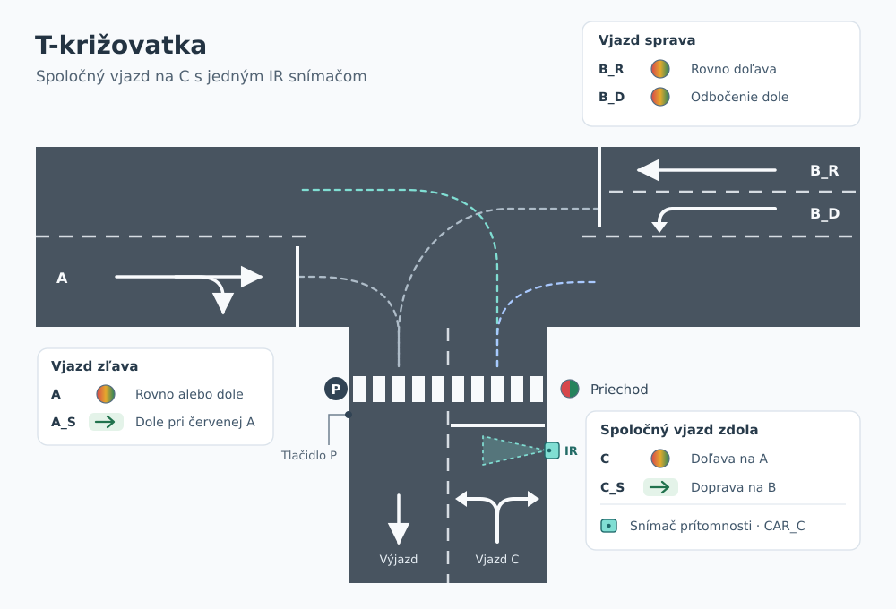
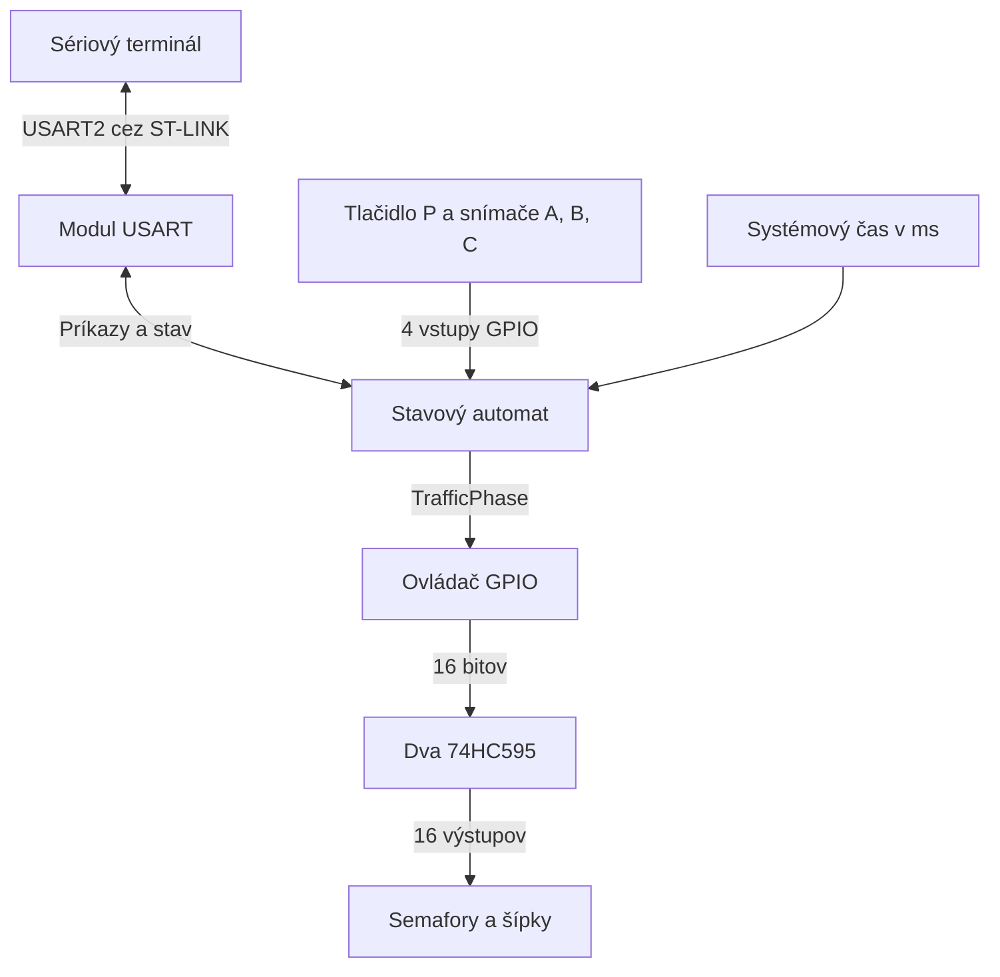
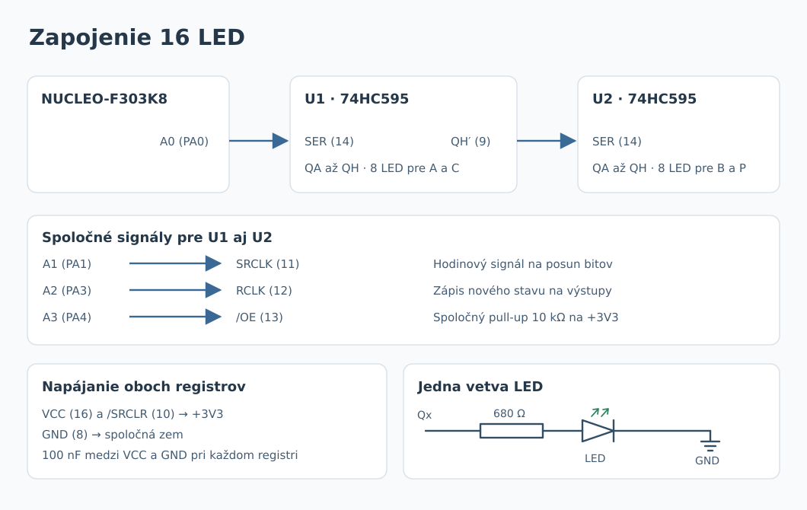

# Model T-križovatky so svetelnou signalizáciou

Tímový projekt z predmetu VRS

## Cieľ a povinný výsledok

Zostavíme model T-križovatky so 16 LED. Na ceste budú štyri trojfarebné semafory a dve doplnkové zelené šípky. Priechod pre chodcov bude mať červenú, zelenú a tlačidlo na vyžiadanie zelenej. Doska STM32 NUCLEO-F303K8 bude riadiť svetlá podľa zvoleného režimu, obsadenosti vjazdov a požiadaviek z terminálu.

Na obhajobe ukážeme, ktoré pohyby môžu ísť súčasne, ako sa vyberá ďalší vjazd a kedy dostanú chodci zelenú. Odmeriame trvanie žltej a spoločnej červenej. V režime **Control** predvedieme samostatné ovládanie semaforov sprava aj oboch šípok.

## Obsah

- [Rozsah projektu](#rozsah-projektu)
- [Prehľad systému](#prehľad-systému)
- [Komunikačný protokol](#komunikačný-protokol)
- [Potrebný hardvér](#potrebný-hardvér)
- [Rozdelenie práce](#rozdelenie-práce)
- [Overenie funkčnosti](#overenie-funkčnosti)
- [Vzdelávacie ciele](#vzdelávacie-ciele)
- [Postup práce v repozitári](#postup-práce-v-repozitári)

## Rozsah projektu

Hlavná cesta vedie v pôdoryse zľava doprava. Vedľajšia cesta sa pripája zdola. Na modeli vyznačíme oddelené pruhy pre protismer a na vjazde sprava rozdelíme príjazd na pruh rovno a pruh na odbočenie dole.

| Označenie | Príjazd | Čo povoľuje zelená | LED |
| --- | --- | --- | --- |
| `A` | Zľava | Pokračovať po hlavnej doprava alebo odbočiť dole | Červená, žltá, zelená |
| `A_S` | Zľava | Odbočiť dole pri červenej na `A` | Zelená šípka |
| `B_R` | Sprava | Pokračovať po hlavnej rovno doľava | Červená, žltá, zelená |
| `B_D` | Sprava | Odbočiť dole na vedľajšiu | Červená, žltá, zelená |
| `C` | Zdola | Odbočiť doľava alebo doprava na hlavnú | Červená, žltá, zelená |
| `C_S` | Zdola | Odbočiť doprava pri červenej na `C` | Zelená šípka |
| `P` | Priechod cez dolnú vetvu | Prejsť cez priechod | Červená, zelená |



*Obr. 1 – Pruhy, povolené smery jednotlivých semaforov a umiestnenie priechodu.*

### Pravidlá signalizácie

- Po inicializácii sa rozsvieti päť červených svetiel. Obe šípky sú zhasnuté. Prvá zelená môže začať po jednej sekunde spoločnej červenej.
- Na každom bežnom semafore svieti v ustálenom stave práve jedna farba. Šípka `A_S` môže svietiť iba pri červenej na `A`. Pre `C_S` platí to isté voči `C`. Pri zelenej pre chodcov sú všetky štyri cestné semafory na červenej a obe šípky zhasnuté.
- Automat povolí iba cestné kombinácie uvedené pri Demo a jednotlivé voľby z tabuľky príkazov v Control. Napríklad `A_S` a `B_D` by viedli do toho istého výjazdového pruhu, preto sa zapínajú v rôznych fázach.
- Pri ukončení fázy šípky zhasnú a bežné cestné semafory, ktoré mali zelenú, prejdú naraz na žltú na 2 s. Pri ukončení fázy so samotnou šípkou alebo chodcami sa prejde rovno na spoločnú červenú. Pred každou ďalšou zelenou musí spoločná červená trvať aspoň 1 s.

### Tlačidlo pre chodcov

Tlačidlo dáme vedľa priechodu P. Zmenu na vstupe potvrdíme po 30 ms stabilného stavu. Pri podržaní tlačidla sa zapíše jedna požiadavka. Automat ju vybaví zapnutím zelenej pre P. Stlačenie počas zelenej pre P patrí do prebiehajúcej fázy. Reset čakajúcu požiadavku vymaže.

### Režim Demo

Na každom vjazde A, B a C budeme sledovať, či pri stopčiare čaká auto. Jeden snímač na B pokrýva oba príjazdové pruhy. Keď automat vyberie B, obslúži najprv smer rovno a potom smer dole.

| Vybraný vjazd | Zelené signály | Prejazd |
| --- | --- | --- |
| A | `A` a `B_R` | Zľava sa dá ísť rovno alebo dole. Sprava ide protismerný pruh rovno. |
| B, prvý krok | `B_R`, `A_S` a `C_S` | Sprava sa ide rovno. Zľava sa dá odbočiť dole a zdola doprava. Na dolnej vetve idú tieto dve odbočenia v oddelených pruhoch. |
| B, druhý krok | `B_D` | Sprava sa odbočuje dole. Obe šípky sú vypnuté. |
| C | `C` | Zdola sa odbočuje na hlavnú doľava alebo doprava. |

V každom kroku svietia zelené signály 5 s. Ostatné bežné semafory a P svietia načerveno. Po zelenej nasleduje 2 s žltej pre príslušné bežné semafory a aspoň 1 s spoločnej červenej. Šípky zhasnú už pri začiatku žltej.

Prvú cestnú fázu vyberieme po štartovacej sekunde spoločnej červenej. Pri výbere prejdeme vjazdy v cyklickom poradí A → B → C od vjazdu, ktorý nasleduje po poslednom obslúženom. Po štarte a po prechode do Demo začneme od A. Prednosť má prvý obsadený vjazd. Keď sú všetky voľné, vyberieme prvý v poradí. Vjazd B je obslúžený po dokončení oboch jeho krokov.

Ak po cestnom kroku čaká požiadavka chodcov, po žltej a spoločnej červenej zapneme P na 5 s. Po P nasleduje aspoň 1 s spoločnej červenej a cestný krok. Ak boli chodci vybavení medzi krokmi B, pokračujeme druhým krokom B.

Automat meria čas od vstupu do fázy podľa systémového času v milisekundách. Hlavná slučka priebežne číta vstupy a spracúva komunikáciu. Žltá a spoločná červená dostanú celý interval aj pri oneskorenej zmene predchádzajúcej fázy.

### Režim Control a zmena režimu

V Control automat čaká pri spoločnej červenej. Obsluha vyberie bežný semafor, šípku alebo P a príkazom môže zapnúť aj oba semafory B spolu. Zelená trvá do platného príkazu na ukončenie alebo na zmenu režimu. Ďalšia voľba sa vykoná po dobehnutí ochranného intervalu.

Snímače a tlačidlo čítame aj v Control. Obsadenosť vjazdov a čakajúceho chodca ukáže `STATUS`. Požiadavka chodcov sa vybaví pri zapnutí zelenej príkazom `SET P GREEN`.

Pri zmene režimu ukončíme aktívnu fázu podľa rovnakých pravidiel. Rozsvietená cestná žltá dobehne, šípky zhasnú a P prejde na červenú. Cieľový režim sa aktivuje po skončení spoločnej červenej. Ak ochranná sekunda už uplynula, režim sa prepne hneď. Čakajúcu požiadavku chodcov si automat prenesie do nového režimu.

## Prehľad systému



- **Stavový automat** vyberá povolené kombinácie, ukladá požiadavku chodcov a vyhodnocuje časy aj príkazy. Modulom odovzdá celú fázu typu `TrafficPhase`.
- **Ovládač GPIO** číta a filtruje štyri vstupy. Podľa fázy zostaví 16-bitové slovo, pošle ho do registrov a jednou hranou `RCLK` prepíše výstupy oboch registrov.
- **Modul USART** prijíma bajty cez prerušenie a skladá riadky v hlavnej slučke. Odovzdáva požiadavky automatu a vypisuje farby, šípky, obsadenosť aj čakajúcu požiadavku chodcov. Príjem aj odosielanie prebiehajú bez čakania v hlavnej slučke.

## Komunikačný protokol

Počítač sa pripojí cez virtuálny sériový port ST-LINK. Použijeme **USART2, 9600 baud, 8 dátových bitov, bez parity, 1 stop bit, bez riadenia toku**. PA2 slúži ako TX a PA15 ako RX. [STMicroelectronics UM1956, sekcia 7.9](https://www.st.com/resource/en/user_manual/um1956-stm32-nucleo32-boards-mb1180-stmicroelectronics.pdf)

Príkazy sú v ASCII a používajú veľké písmená. Jedna medzera oddeľuje susedné položky. Parameter `<cieľ>` je `A`, `A_S`, `B_R`, `B_D`, `C`, `C_S` alebo `P`. Cieľ `B` zahŕňa oba semafory na vjazde sprava. Prijatý riadok má najviac 32 znakov pred `LF` alebo `CRLF`. Prázdne riadky sa preskočia. Na každý neprázdny riadok zariadenie odpovie jedným riadkom s koncom `CRLF`. Terminál odošle ďalší príkaz po prijatí odpovede.

| Príkaz | Správanie |
| --- | --- |
| `MODE DEMO` | Vyžiada prechod do Demo. V ustálenom režime Demo potvrdí aktuálny stav. |
| `MODE CONTROL` | Vyžiada prechod do Control. V ustálenom režime Control potvrdí aktuálny stav. |
| `SET <cieľ> GREEN` | Zapne zvolenú zelenú pri `READY=1`. Pre `A_S` a `C_S` tým rozsvieti šípku pri červenej na príslušnom bežnom semafore. Pri `B` zapne obe zelené sprava. Ak už všetky požadované signály svietia nazeleno, potvrdí ich stav. Pri inej aktívnej fáze alebo počas ochranného intervalu vráti `ERR CONFLICT`. |
| `SET <cieľ> YELLOW` | Ukončí aktuálnu zelenú, ak cieľ zahŕňa práve zelený bežný cestný semafor. Na 2 s sa zapne žltá na bežných semaforoch, ktoré v tejto fáze mali zelenú. |
| `SET <cieľ> RED` | Ak cieľ zahŕňa práve zelený signál, ukončí celú aktívnu fázu. Cestná zelená dobehne cez žltú. Šípka zhasne a P prejde priamo na červenú. Pri žltej, červenej alebo zhasnutej šípke príkaz potvrdí aktuálny stav bez zmeny časovania. |
| `STATUS` | Vráti režim, stav prepínania, pripravenosť, farby semaforov, stav šípok, obsadenosť vjazdov a čakajúcu požiadavku chodcov. |

Príkazy `SET` sa vykonávajú v režime Control po skončení prípadného prepínania. Počas prepínania je dostupný `STATUS`. Opakovanie príkazu na ten istý cieľový režim dostane `OK` a časovanie pokračuje.

| Odpoveď | Význam |
| --- | --- |
| `OK` | Príkaz bol prijatý. Priebeh časovaného prechodu ukáže `STATUS`. |
| `ERR SYNTAX` | Neznámy príkaz, cieľ, režim, farba alebo chybný formát riadka. |
| `ERR LENGTH` | Riadok prekročil 32 znakov. Prijímač zahodí zvyšok po koniec riadka a potom prijíma ďalší príkaz. |
| `ERR BUSY` | Počas prepínania prišiel `SET` alebo požiadavka na návrat do práve opúšťaného režimu. |
| `ERR MODE` | Používateľ poslal `SET` v režime Demo. |
| `ERR STATE` | Príkaz na žltú sa netýka žiadneho práve zeleného bežného cestného semafora. |
| `ERR CONFLICT` | Novú zelenú sme vyžiadali pri aktívnej fáze, žltej alebo počas ochrannej červenej. |

Príklad odpovede na `STATUS` v Control pri obsadenom vjazde B a čakajúcom chodcovi

```text
OK MODE=CONTROL NEXT=- READY=1 A=RED A_S=OFF B_R=RED B_D=RED C=RED C_S=OFF P=RED CAR=010 P_REQ=1
```

`NEXT` obsahuje cieľový režim pri prepínaní alebo `-` mimo neho. `READY=1` znamená, že Control môže prijať novú zelenú. Šípky sa vypisujú ako `ON` alebo `OFF`. Tri číslice v `CAR` patria postupne vjazdom A, B a C, pričom `1` znamená obsadený vjazd. `P_REQ=1` označuje čakajúcu požiadavku chodcov. Po zapnutí zelenej pre P má `P_REQ` hodnotu `0`.

## Potrebný hardvér

| Položka | Počet | Použitie |
| --- | ---: | --- |
| STM32 NUCLEO-F303K8 | 1 | Riadenie, programovanie a sériová komunikácia cez ST-LINK |
| 74HC595, napr. SN74HC595N v DIP-16 | 2 | Dva posuvné registre pre 16 LED |
| Červená LED | 5 | `A`, `B_R`, `B_D`, `C` a `P` |
| Žltá LED | 4 | `A`, `B_R`, `B_D` a `C` |
| Zelená LED | 7 | Štyri cestné zelené, dve šípky a `P` |
| Rezistor 680 Ω | 16 | Jeden sériový rezistor na každú LED |
| Rezistor 10 kΩ | 1 | Pull-up na spoločnom vstupe `/OE` |
| Kondenzátor 100 nF | 2 | Blokovanie napájania pri registroch |
| Spínacie tlačidlo (NO) | 1 | Požiadavka pri priechode P |
| Infračervený snímač s prerušením lúča, 3,3 V | 3 súpravy | Vysielač a prijímač na každom z vjazdov A, B a C |
| Model auta | 1 | Skúška obsadenosti vjazdov |
| Kontaktné pole a vodiče | 1 súprava | Prepojenie dosky, registrov, svetiel a vstupov |
| Podložka a materiál na model | 1 súprava | Vozovka, priechod a uchytenie svetiel a snímačov |
| Počítač a USB dátový kábel | 1 súprava | Napájanie z USB, nahratie programu a terminál |

### Zapojenie LED

Použijeme dva registre `74HC595` napájané z `+3V3` na NUCLEO. Prvý označíme U1 a jeho sériový výstup `QH′` prepojíme so vstupom `SER` druhého registra U2. STM32 pošle najprv bajt pre U2 a potom bajt pre U1, oba od najvyššieho bitu. Na každý bit použije vzostupnú hranu `SRCLK`. Po prenose vzostupná hrana `RCLK` nastaví všetkých 16 výstupov. [Texas Instruments, SN74HC595](https://www.ti.com/lit/ds/symlink/sn74hc595.pdf)

| Signál | Potlač na doske | Pin STM32 | Konektor | Pripojenie na 74HC595 |
| --- | --- | --- | --- | --- |
| Dáta `SER` | A0 | PA0 | CN4/12 | U1 pin 14 |
| Posun `SRCLK` | A1 | PA1 | CN4/11 | U1 aj U2 pin 11 |
| Zápis `RCLK` | A2 | PA3 | CN4/10 | U1 aj U2 pin 12 |
| Povolenie výstupov `/OE` | A3 | PA4 | CN4/9 | U1 aj U2 pin 13 |

Na oboch registroch pripojíme `VCC` (16) a `/SRCLR` (10) na `+3V3`, `GND` (8) na spoločnú zem a medzi napájacie piny dáme 100 nF. Sériová prepojka vedie z U1 pinu 9 na U2 pin 14. Spoločný `/OE` pritiahneme cez 10 kΩ k 3,3 V. Pri resete sú výstupy vypnuté. Po zápise spoločnej červenej nastaví STM32 `/OE` na nulu a rozsvieti päť červených.

Každý výstup pripojíme cez vlastný rezistor 680 Ω k anóde LED. Katódy pôjdu na spoločnú zem. Pri úbytku približne 2 V na LED vychádza prúd okolo 2 mA. Viditeľnosť svetiel overíme pri oživení.

| Výstup | Pin na registri | U1 – vjazdy A a C | U2 – vjazd B a priechod |
| --- | ---: | --- | --- |
| `QA` | 15 | A červená | B_R červená |
| `QB` | 1 | A žltá | B_R žltá |
| `QC` | 2 | A zelená | B_R zelená |
| `QD` | 3 | A_S zelená šípka | B_D červená |
| `QE` | 4 | C červená | B_D žltá |
| `QF` | 5 | C žltá | B_D zelená |
| `QG` | 6 | C zelená | P červená |
| `QH` | 7 | C_S zelená šípka | P zelená |

Pri spoločnej červenej zodpovedá tabuľke slovo `0x4911`. Najprv vyšleme `0x49` pre U2 a potom `0x11` pre U1.



*Obr. 2 – Prepojenie registrov a zapojenie jednej vetvy LED. Ostatné LED sa zapoja rovnako podľa tabuľky výstupov.*

### Zapojenie tlačidla a snímačov

Tlačidlo zapojíme medzi `P_BTN` a GND. Na A a C dáme vysielač a prijímač oproti sebe pri stopčiare. Na B pôjde lúč naprieč oboma príjazdovými pruhmi, aby zachytil auto v ktoromkoľvek z nich. Na C umiestnime snímač pred priechod v smere jazdy. Použiť môžeme napríklad súpravu Adafruit 2167. [Parametre snímača](https://www.adafruit.com/product/2167)

Vysielače aj prijímače napájame z `+3V3` (CN4/14) a pripojíme na spoločnú zem. Každý vstup nastavíme ako `GPIO_Input` s interným pull-up. Pri stlačení tlačidla alebo prerušení lúča čítame logickú nulu. Zmenu obsadenosti potvrdíme po 30 ms stabilnej úrovne. [Zapojenie a polarita výstupu snímača](https://learn.adafruit.com/ir-breakbeam-sensors/arduino)

| Vstup | Potlač na doske | Pin STM32 | Konektor |
| --- | --- | --- | --- |
| Tlačidlo `P_BTN` | D0 | PA10 | CN3/2 |
| Prijímač `CAR_A` | D1 | PA9 | CN3/1 |
| Prijímač `CAR_B` | D12 | PB4 | CN3/15 |
| Prijímač `CAR_C` | D2 | PA12 | CN3/5 |

Snímač C pripojíme na D2, ktorý sa uvoľní po presunutí LED na registre. V CubeMX nastavíme štyri výstupy pre registre, štyri vstupy a ladenie cez `Serial Wire`. [STMicroelectronics UM1956, tabuľka 12](https://www.st.com/resource/en/user_manual/um1956-stm32-nucleo32-boards-mb1180-stmicroelectronics.pdf)

## Rozdelenie práce

Každý člen navrhne, naprogramuje a overí vlastný modul. K modulu odovzdá zdrojové súbory a výsledky troch uvedených skúšok. Pri obhajobe svoju časť predvedie na spoločnom modeli.

| Člen a vetva | Návrh a implementácia | Samostatný výstup a obhajoba |
| --- | --- | --- |
| **Branislav Krajčovič** · `feature/traffic-fsm` | V `traffic_fsm.c/.h` pripraví kombinácie fáz, výber vjazdov, ukončenie zelenej a ochranné intervaly. Doplní vybavenie požiadavky chodcov a spracovanie príkazov v Control. | Tabuľka prechodov, kód automatu a skúšky F1–F3. Predvedie súbeh pohybov, voľbu vjazdu a odmietnutie kolíznej požiadavky. |
| **Miroslav Kučera** · `feature/model-gpio` | Zhotoví model, zapojí 16 LED, dva registre, tlačidlo a tri snímače. Nakonfiguruje GPIO v CubeMX. V `traffic_gpio.c/.h` naprogramuje mapovanie LED, zápis do registrov, inicializáciu a filtrovanie vstupov. | Model, schéma zapojenia, kód ovládača a skúšky H1–H3. Predvedie obe šípky, samostatné semafory B a čítanie vstupov. |
| **Samuel Jantošovič** · `feature/usart-control` | Navrhne formát protokolu a konfiguráciu USART2. V `traffic_serial.c/.h` naprogramuje príjem a odosielanie cez prerušenia, skladanie riadkov, overenie cieľov a výpis svetiel, šípok aj vstupov. | Popis protokolu, kód komunikácie a skúšky U1–U3 so záznamom z terminálu. Predvedie ručné ovládanie a spracovanie chybného vstupu. |

## Overenie funkčnosti

| Skúška | Postup a očakávaný výsledok |
| --- | --- |
| **F1 – Výber cestnej fázy** | Pri voľných vjazdoch overíme poradie A → B (rovno so šípkami, potom dole) → C. Pri obsadenom C dostane po ochrannej červenej prednosť C. Pri obsadených A a C sa pri výbere striedajú. |
| **F2 – Šípky, kolízie a chodci** | Počas prvého kroku B stlačíme a podržíme tlačidlo. Pri ukončení fázy šípky zhasnú, `B_R` prejde na žltú a potom nasleduje spoločná červená a P. Po skončení P a ochrannej červenej sa rozsvieti `B_D`. V Control pri zelenej `B_D` vyžiadame `SET A_S GREEN` a očakávame `ERR CONFLICT`. |
| **F3 – Prepnutie režimu** | Počas zelenej so šípkami stlačíme tlačidlo a prepneme do Control. Overíme zhasnutie šípok, dobeh žltej, spoločnú červenú a `P_REQ=1` vo výpise. Potom zapneme P a počas jeho zelenej vyžiadame Demo. P má prejsť na červenú a Demo začne až po ochrannej sekunde. |
| **H1 – Mapa LED** | Pri skúške na stole zapneme postupne všetkých 16 výstupov, vždy jeden. Overíme farbu, semafor a smer šípky podľa tabuľky. |
| **H2 – Inicializácia a prechod** | Resetujeme dosku počas aktívnej fázy. Prvý rozsvietený stav má päť červených. Pri zmene fázy overíme, že LED sa prepnú až po zápise `RCLK`. |
| **H3 – Čítanie vstupov** | Prerušíme a uvoľníme lúč na každom vjazde a na B skúsime oba pruhy. Pri podržaní tlačidla sa zaznamená jedno stlačenie, ďalšie až po uvoľnení a novom stlačení. |
| **U1 – Ovládanie a výpis stavu** | Po `READY=1` zapneme `SET B_R GREEN`. `STATUS` ukáže `B_R=GREEN` a `B_D=RED`. Rovnakým postupom skúsime `B_D`, oba semafory cez cieľ `B` a samostatne obe šípky. Pred každým novým povolením ukončíme predchádzajúcu fázu a počkáme na `READY=1`. Pri `STATUS` s `LF` aj `CRLF` overíme úplný výpis vrátane `CAR` a `P_REQ`. |
| **U2 – Chybný vstup a obnova príjmu** | V Control pošleme `SET X GREEN`, `SET A_S YELLOW` a riadok s 33 znakmi. Očakávame `ERR SYNTAX`, `ERR STATE` a `ERR LENGTH`. Nasledujúci `STATUS` sa spracuje normálne. |
| **U3 – Príkazy počas behu** | V Demo pošleme `SET A RED` a overíme `ERR MODE`. Počas zelenej pošleme `MODE CONTROL` a hneď po `OK` príkaz `SET P GREEN`. Počas prepínania má prísť `ERR BUSY`. |

### Spoločná skúška na hotovom modeli

1. Po resete skontrolujeme spoločnú červenú. Pri voľných vjazdoch zaznamenáme cestné kroky z tabuľky Demo. Z videa určíme trvanie zelenej, žltej a spoločnej červenej.
2. Počas prvého kroku B stlačíme tlačidlo. Overíme poradie `B_R` so šípkami → žltá `B_R` bez šípok → spoločná červená → `P` → spoločná červená → `B_D`. Pri zelenej P skontrolujeme červenú na všetkých cestných semaforoch aj zhasnutie oboch šípok.
3. V Control po `READY=1` zadáme `SET A_S GREEN`. Na A má svietiť červená spolu so šípkou. Príkaz `SET B_D GREEN` musí vrátiť `ERR CONFLICT`. Po `SET A_S RED` a skončení spoločnej červenej zopakujeme príkaz pre `B_D` a overíme `OK` aj stav na modeli.

K vyhodnoteniu priložíme namerané časy a záznam z terminálu s príkazmi a odpoveďami.

## Vzdelávacie ciele

- Nakonfigurovať GPIO v STM32CubeMX, čítať snímače a odfiltrovať zákmity tlačidla.
- Prepojiť dva posuvné registre a overiť mapovanie výstupov na 16 LED.
- Navrhnúť stavový automat s neblokujúcim časovaním a otestovať povolené prechody.
- Prijímať a odosielať dáta cez USART pomocou prerušení a spracovať platné aj chybné príkazy.
- Dohodnúť rozhrania medzi modulmi v C a overiť ich spoluprácu na spoločnom modeli.

## Postup práce v repozitári

1. Na vetve `main` pripravíme spoločný projekt v STM32CubeIDE, mapu pinov, typy pre rozhrania a súbor `README.md`. Konfiguráciu `.ioc` zapracuje Miroslav po dohode s Branislavom a Samuelom.
2. Každý člen vyvinie a odskúša svoj modul vo vlastnej vetve. Do `main` sa zmeny dostanú po kontrole kolegom cez pull request.
3. Po spojení modulov overíme ich spoluprácu podľa [spoločnej skúšky na hotovom modeli](#spoločná-skúška-na-hotovom-modeli).
4. Pred obhajobou zostavíme projekt z `main`, nahráme ho cez ST-LINK a vykonáme skúšky na hotovom modeli. Výsledky zaznamenáme spolu s mapou zapojenia a ukážkou komunikácie.
