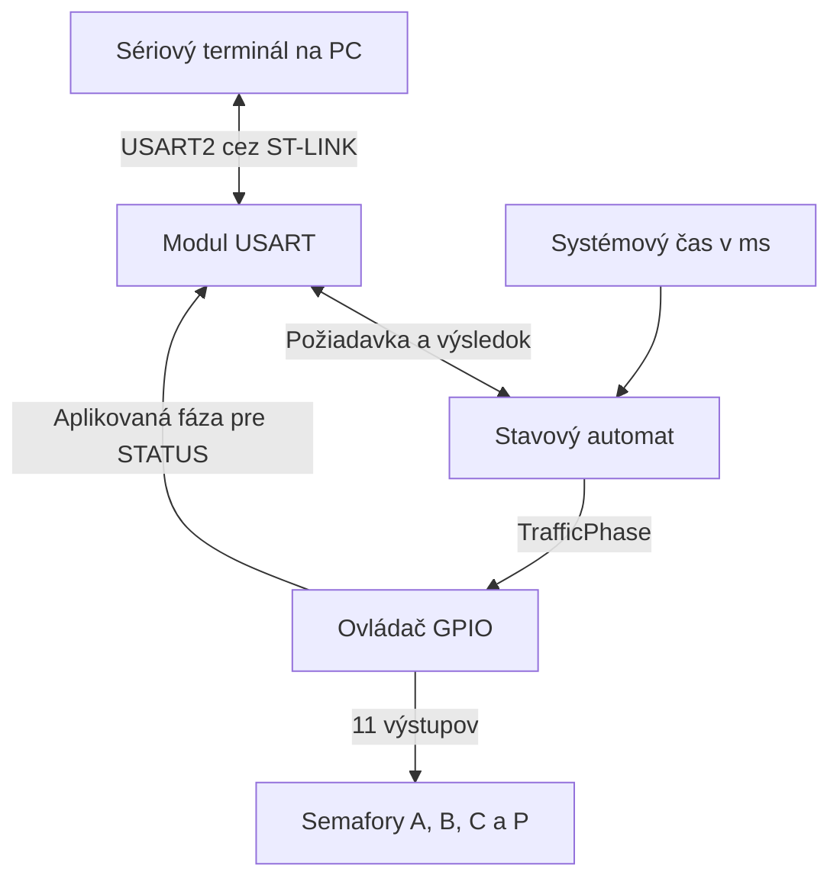
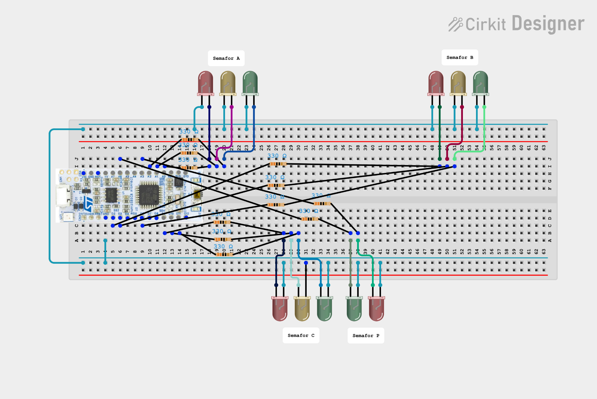

# Model T-križovatky so svetelnou signalizáciou

Tímový projekt z predmetu VRS

## Cieľ a povinný výsledok

Zostavíme model T-križovatky s tromi cestnými semaformi a jedným priechodom pre chodcov. Doska STM32 NUCLEO-F303K8 bude riadiť oba režimy podľa rovnakých pravidiel. Zelenú môže dostať naraz najviac jeden semafor.

Na obhajobe predvedieme funkčný model, celý cyklus **Demo** a ručné ovládanie v režime **Control** cez sériový terminál. Na výstupoch overíme dĺžku žltej a spoločnej červenej. Pri zelenej pre vozidlá odošleme požiadavku na zelenú pre chodcov a overíme odpoveď `ERR CONFLICT` aj stav svetiel.

## Obsah

- [Rozsah projektu](#rozsah-projektu)
- [Prehľad systému](#prehľad-systému)
- [Komunikačný protokol](#komunikačný-protokol)
- [Potrebný hardvér](#potrebný-hardvér)
- [Rozdelenie práce](#rozdelenie-práce)
- [Overenie funkčnosti](#overenie-funkčnosti)
- [Vzdelávacie ciele](#vzdelávacie-ciele)
- [Postup práce v repozitári](#postup-práce-v-repozitári)

## Rozsah projektu

Projekt zahŕňa zapojenie modelu, ovládač GPIO, stavový automat a komunikáciu cez USART2. V režime **Demo** beží pevná sekvencia fáz. V režime **Control** používateľ žiada zmenu svetiel z terminálu. Výpis stavu a prepínanie režimov sú dostupné v oboch režimoch.

| Označenie | Umiestnenie na modeli | Svetlá |
| --- | --- | --- |
| A | Vjazd zľava po hlavnej ceste | Červená, žltá, zelená |
| B | Vjazd sprava po hlavnej ceste | Červená, žltá, zelená |
| C | Vjazd z dolnej vetvy križovatky | Červená, žltá, zelená |
| P | Priechod naprieč dolnou vetvou | Červená, zelená |

*Obr. 1 – Rozmiestnenie semaforov a smer príjazdu do križovatky.*

Cestný semafor riadi všetky jazdné smery zo svojho vjazdu. Pre model budeme považovať všetky dvojice vjazdov za kolízne. Priechod P bude mať samostatnú fázu, pri ktorej budú všetky cestné semafory na červenej.

### Pravidlá signalizácie

- Po inicializácii sa rozsvietia štyri červené svetlá. Režim Demo začne prvou zelenou až po jednej sekunde spoločnej červenej.
- V každom ustálenom stave svieti na každom semafore práve jedna farba. Ak má niektorý cestný semafor zelenú alebo žltú, ostatné semafory svietia načerveno. Pri zelenej pre chodcov svietia všetky tri cestné semafory načerveno.
- Cestná zelená sa ukončuje dvojsekundovou žltou. Po žltej alebo po skončení zelenej pre chodcov nasleduje najmenej jedna sekunda spoločnej červenej. Až potom je možné zapnúť zelenú.
- Rovnaké pravidlá vyhodnocuje jeden stavový automat pre Demo, Control aj prechod medzi režimami. Pri odmietnutí príkazu pokračuje už naplánované časovanie aktuálnej fázy.

### Režim Demo

Po štartovacej sekunde spoločnej červenej prebieha nasledujúci cyklus s menovitou dĺžkou 30 s. Za poslednou fázou nasleduje opäť krok 1.

| Krok | A | B | C | P | Trvanie |
| ---: | --- | --- | --- | --- | ---: |
| 1 | Zelená | Červená | Červená | Červená | 5 s |
| 2 | Žltá | Červená | Červená | Červená | 2 s |
| 3 | Červená | Červená | Červená | Červená | 1 s |
| 4 | Červená | Zelená | Červená | Červená | 5 s |
| 5 | Červená | Žltá | Červená | Červená | 2 s |
| 6 | Červená | Červená | Červená | Červená | 1 s |
| 7 | Červená | Červená | Zelená | Červená | 5 s |
| 8 | Červená | Červená | Žltá | Červená | 2 s |
| 9 | Červená | Červená | Červená | Červená | 1 s |
| 10 | Červená | Červená | Červená | Zelená | 5 s |
| 11 | Červená | Červená | Červená | Červená | 1 s |

Automat bude vyhodnocovať uplynutý čas od vstupu do fázy podľa milisekundového systémového času. Hlavná slučka bude medzi zmenami svetiel priebežne spracúvať komunikáciu. Žltá a spoločná červená dostanú celý interval aj vtedy, keď sa predchádzajúca fáza skončí s oneskorením.

### Režim Control a zmena režimu

V ručnom režime automat po skončení spoločnej červenej čaká na príkaz. Používateľ môže vybrať zelenú na ktoromkoľvek zo štyroch semaforov. Zelená zostane svietiť do prijatia platného príkazu na ukončenie fázy alebo zmenu režimu. Cestná žltá a interval spoločnej červenej dobehnú automaticky.

Pri požiadavke na zmenu režimu sa cestná zelená ukončí cez žltú, prebiehajúca žltá dobehne a zelená pre chodcov prejde na červenú. Automat dokončí interval spoločnej červenej a potom aktivuje cieľový režim. Ak už tento interval uplynul, režim sa prepne ihneď. Po prechode do Demo cyklus začne zelenou pre A. Po prechode do Control zostanú všetky semafory na červenej a automat bude čakať na príkaz.

## Prehľad systému

- **Stavový automat** dostáva aktuálny čas a požiadavky z USART. Určuje režim, fázu a výsledok požiadavky. Výstupom je jedna fáza zo spoločného typu `TrafficPhase` (spoločná červená, zelená alebo žltá jedného cestného semafora, zelená pre chodcov).
- **Ovládač GPIO** prevádza celú fázu na kombináciu 11 výstupov. Pri zmene najprv vypne končiacu zelenú alebo žltú, nastaví červené svetlá a potom zapne novú žltú alebo zelenú podľa fázy. Po inicializácii nastaví spoločnú červenú.
- **Modul USART** prijíma bajty cez prerušenie a spracúva celé riadky v hlavnej slučke. Z príkazov vytvorí požiadavky pre automat a z jeho výsledku zostaví odpoveď. Pri `STATUS` vypíše farby poslednej fázy aplikovanej na GPIO. Príjem aj odosielanie budú prebiehať bez čakania v hlavnej slučke.

## Komunikačný protokol

Počítač sa pripojí cez virtuálny sériový port ST-LINK. Použijeme **USART2, 9600 baud, 8 dátových bitov, bez parity, 1 stop bit, bez riadenia toku**. Na doske vyhradíme PA2 pre TX a PA15 pre RX. [STMicroelectronics UM1956, sekcia 7.9](https://www.st.com/resource/en/user_manual/dm00231744-stm32-nucleo-32-boards-mb1180-stmicroelectronics.pdf)

Príkazy sú v ASCII a používajú veľké písmená. Jedna medzera oddeľuje susedné položky. Parameter `<semafor>` nadobúda hodnoty `A`, `B`, `C` alebo `P`. Jeden riadok má najviac 32 znakov pred ukončením `LF` alebo `CRLF`. Prázdne riadky sa preskočia. Na každý neprázdny riadok zariadenie odpovie jedným riadkom s koncom `CRLF`. Terminál odošle ďalší príkaz po prijatí odpovede.

| Príkaz | Správanie |
| --- | --- |
| `MODE DEMO` | Vyžiada prechod do Demo. Opakovanie príkazu v aktívnom režime Demo potvrdí aktuálny režim. |
| `MODE CONTROL` | Vyžiada prechod do Control. Opakovanie príkazu v aktívnom režime Control potvrdí aktuálny režim. |
| `SET <semafor> GREEN` | Povolí zvolený semafor zo stavu spoločnej červenej po uplynutí jej intervalu. Opakovaný príkaz pre semafor, ktorý už svieti nazeleno, dostane potvrdenie. Pri obsadenej fáze alebo počas intervalu spoločnej červenej vráti chybu. |
| `SET <semafor> YELLOW` | Ukončí zelenú na zvolenom cestnom semafore. Po dvojsekundovej žltej nasleduje spoločná červená. Platí pre A, B alebo C, keď daný semafor svieti nazeleno. |
| `SET <semafor> RED` | Ukončí zelenú na vybranom semafore. Pre A, B a C začne žltou. Pre P zapne červenú a začne interval spoločnej červenej. Ak je vybraný semafor už žltý, žltá dobehne. Ak je červený, zariadenie potvrdí jeho aktuálny stav. |
| `STATUS` | Vráti aktívny režim, prípadný cieľ prebiehajúceho prepnutia, pripravenosť na ručné povolenie a nastavené farby A, B, C, P. |

Príkazy `SET` sa vykonávajú v režime Control po dokončení prípadného prepnutia režimu. Počas prepínania možno čítať `STATUS` a zopakovať požiadavku na ten istý cieľový režim. Opakovaná požiadavka dostane `OK` a prechod pokračuje podľa pôvodného časovania.

| Odpoveď | Význam |
| --- | --- |
| `OK` | Platný príkaz bol prijatý. Pri časovanom prechode ukáže jeho priebeh `STATUS`. |
| `OK MODE=CONTROL NEXT=- READY=1 A=RED B=RED C=RED P=RED` | Príklad odpovede na `STATUS` po prechode do Control. `NEXT` obsahuje cieľový režim počas prepínania alebo `-` mimo neho. `READY=1` znamená, že Control čaká pri spoločnej červenej po uplynutí ochranného intervalu. V ostatných prípadoch je hodnota `0`. |
| `ERR SYNTAX` | Neznámy príkaz, chybný formát riadka, neznámy režim, semafor alebo farba. |
| `ERR LENGTH` | Riadok prekročil 32 znakov. Prijímač zahodí jeho zvyšok po koniec riadka a potom prijíma ďalší príkaz. |
| `ERR BUSY` | Počas prepínania režimu prišiel `SET` alebo požiadavka na návrat do práve opúšťaného režimu. |
| `ERR MODE` | Používateľ poslal `SET` v aktívnom režime Demo. |
| `ERR STATE` | Používateľ požiadal o žltú pre P alebo pre cestný semafor, ktorý nemá zelenú. |
| `ERR CONFLICT` | Požiadavka na novú zelenú pri aktívnej zelenej, žltej alebo počas intervalu spoločnej červenej. |

## Potrebný hardvér

| Položka | Počet | Použitie |
| --- | ---: | --- |
| STM32 NUCLEO-F303K8 | 1 | Riadenie modelu, programovanie a sériová komunikácia cez ST-LINK |
| Červená LED | 4 | A, B, C a P |
| Žltá LED | 3 | A, B a C |
| Zelená LED | 4 | A, B, C a P |
| Rezistor 330 Ω | 11 | Jeden sériový rezistor pre každú LED |
| Kontaktné pole a prepojovacie vodiče | 1 súprava | Prepojenie dosky a svetiel |
| Podložka a materiál na stavbu modelu | 1 súprava | Vozovka, priechod a držiaky semaforov |
| Počítač a USB dátový kábel | 1 súprava | Napájanie z USB, nahratie programu a ovládanie z terminálu |

### Návrh zapojenia

Každý pin vyhradený pre LED nastavíme ako výstup typu push-pull. Pripojí sa cez vlastný rezistor k anóde LED. Katódy sa spoja so zemou dosky, napríklad na CN3/4. LED bude svietiť pri logickej jednotke. Pri napätí 3,3 V a úbytku 2,0 V na LED vychádza s rezistorom 330 Ω prúd približne 3,9 mA. Viditeľnosť a polaritu overíme pri oživení modelu. [STMicroelectronics DS9866, elektrické vlastnosti GPIO](https://www.st.com/resource/en/datasheet/stm32f303k8.pdf)

| Semafor | Červená | Žltá | Zelená |
| --- | --- | --- | --- |
| A | PA0 · A0 · CN4/12 | PA1 · A1 · CN4/11 | PA3 · A2 · CN4/10 |
| B | PA12 · D2 · CN3/5 | PB0 · D3 · CN3/6 | PB1 · D6 · CN3/9 |
| C | PA8 · D9 · CN3/12 | PA11 · D10 · CN3/13 | PB5 · D11 · CN3/14 |
| P | PA4 · A3 · CN4/9 | — | PA7 · A6 · CN4/6 |

V tabuľke je uvedené označenie pinu STM32, potlač na doske a pozícia na konektore. [STMicroelectronics UM1956, tabuľka 12](https://www.st.com/resource/en/user_manual/dm00231744-stm32-nucleo-32-boards-mb1180-stmicroelectronics.pdf)

*Obr. 2 – Zapojenie semaforov na breadboarde. Výkres z Cirkit Designeru.*

## Rozdelenie práce

Každý člen navrhne, naprogramuje a overí vlastný modul. K modulu odovzdá zdrojové súbory a výsledky troch uvedených skúšok. Pri obhajobe svoju časť predvedie na spoločnom modeli.

| Člen a vetva | Návrh a implementácia | Samostatný výstup a obhajoba |
| --- | --- | --- |
| **Branislav Krajčovič** · `feature/traffic-fsm` | Navrhne tabuľku stavov a prechodov. V `traffic_fsm.c/.h` naprogramuje neblokujúce časovanie, cyklus Demo, rozhodovanie o príkazoch v Control a prepínanie režimov. | Tabuľka prechodov, zdrojový kód automatu a skúšky F1–F3. Predvedie celý cyklus, ochranné intervaly a odmietnutie kolíznej požiadavky. |
| **Miroslav Kučera** · `feature/model-gpio` | Navrhne a zhotoví fyzický model a zapojenie 11 LED. Nakonfiguruje GPIO v CubeMX a v `traffic_gpio.c/.h` naprogramuje mapovanie fáz na piny, inicializáciu a poradie zmeny výstupov. | Model, schéma zapojenia, zdrojový kód ovládača a skúšky H1–H3. Predvedie mapovanie všetkých LED a zmenu svetiel pri prechode fáz. |
| **Samuel Jantošovič** · `feature/usart-control` | Navrhne formát protokolu a konfiguráciu USART2. V `traffic_serial.c/.h` naprogramuje príjem a odosielanie cez prerušenia, skladanie riadkov, overenie príkazov a prevod výsledkov automatu na odpovede. | Popis protokolu, zdrojový kód komunikácie a skúšky U1–U3 so záznamom z terminálu. Predvedie ovládanie, výpis stavu a reakciu na chybný vstup. |

## Overenie funkčnosti

| Skúška | Postup a očakávaný výsledok |
| --- | --- |
| **F1 – Časovanie Demo** | Po inicializácii prejde model cez 1 s spoločnej červenej a potom dvakrát zopakuje poradie A → B → C → P. Pri skúške s riadeným časom sa fázy porovnajú s tabuľkou Demo, vrátane konca žltej a konca spoločnej červenej. |
| **F2 – Kolízie** | V Control sa pri zelenej A vyžiada zelená B aj P, pri zelenej P sa vyžiada zelená C. Odpoveď je `ERR CONFLICT`. Ďalšia zelená sa zamietne aj počas žltej a intervalu spoločnej červenej. Po ich uplynutí sa platný príkaz prijme. |
| **F3 – Prepnutie režimu** | Zmeniť režim počas cestnej zelenej a počas zelenej pre chodcov. Cestná fáza prejde cez celú žltú aj spoločnú červenú, chodcovská cez spoločnú červenú. Control zostane čakať a Demo začne fázou A. |
| **H1 – Mapa LED** | Samostatným skúšobným programom ovládača nastaviť všetkých osem výstupných fáz. Pri každej fáze overiť podľa tabuľky, že svietia správne LED na všetkých štyroch semaforoch. |
| **H2 – Inicializácia** | Resetovať dosku počas aktívnej fázy. Prvý zobrazený stav po inicializácii GPIO je spoločná červená. |
| **H3 – Zmena výstupov** | Na modeli overiť cestný prechod zelená → žltá → spoločná červená a následné zapnutie zelenej pre P. Krokovaním ovládača overiť, že zápis na vypnutie končiacej farby predchádza zápisu na zapnutie nasledujúcej. |
| **U1 – Platné príkazy** | Poslať `STATUS` s `LF` aj `CRLF`. Poslať `MODE CONTROL`, počkať na `READY=1`, zadať `SET A GREEN` a overiť `OK` aj výpis `A=GREEN`. |
| **U2 – Chybný vstup a obnova príjmu** | V Control poslať `SET X GREEN`, `SET P YELLOW` a riadok s 33 znakmi. Zariadenie postupne vráti `ERR SYNTAX`, `ERR STATE`, `ERR LENGTH` a potom spracuje platný `STATUS`. |
| **U3 – Komunikácia počas cyklu** | Počas Demo opakovane poslať `STATUS` a jeden príkaz `SET A RED`. Výpis zachytí meniace sa fázy, `SET` vráti `ERR MODE` a cyklus pokračuje podľa tabuľky. Počas cestnej zelenej poslať `MODE CONTROL` a hneď po `OK` poslať `SET P GREEN`. Počas prepínania je očakávaná odpoveď `ERR BUSY`. |

### Spoločná skúška na hotovom modeli

1. Po resete skontrolujeme spoločnú červenú a zaznamenáme dva celé cykly Demo. Z časových značiek na videu určíme trvanie jednotlivých fáz a celého cyklu. Pri žltej očakávame 2 s, pri spoločnej červenej aspoň 1 s a pri celom cykle menovitých 30 s.
2. Odošleme `MODE CONTROL` a cez `STATUS` počkáme na `READY=1`. Po `SET A GREEN` očakávame `OK` a zelenú na A. Potom pošleme `SET P GREEN`. Zariadenie má vrátiť `ERR CONFLICT` a výpis `STATUS` má ukázať `A=GREEN` a `P=RED`. Farby skontrolujeme aj priamo na modeli.
3. Príkazom `SET A RED` ukončíme fázu A. Po žltej a spoločnej červenej počkáme na `READY=1` a zopakujeme `SET P GREEN`. Očakávame `OK`, zelenú na P a červenú na všetkých troch cestných semaforoch.

K vyhodnoteniu priložíme namerané časy a záznam z terminálu s príkazmi a odpoveďami.

## Vzdelávacie ciele

- Nakonfigurovať GPIO v STM32CubeMX a overiť výstupy na fyzickom modeli.
- Navrhnúť stavový automat s neblokujúcim časovaním a otestovať prechody medzi fázami.
- Prijímať a odosielať dáta cez USART pomocou prerušení a spracovať platné aj chybné príkazy.
- Dohodnúť rozhrania medzi modulmi v C a overiť ich spoluprácu na spoločnom modeli.

## Postup práce v repozitári

1. Na vetve `main` pripravíme spoločný projekt v STM32CubeIDE, mapu pinov, typy pre rozhrania a súbor `README.md`. Konfiguráciu `.ioc` zapracuje Miroslav po dohode s Branislavom a Samuelom.
2. Každý člen vyvinie a odskúša svoj modul vo vlastnej vetve. Do `main` sa zmeny dostanú po kontrole kolegom cez pull request.
3. Po spojení modulov overíme ich spoluprácu podľa [spoločnej skúšky na hotovom modeli](#spoločná-skúška-na-hotovom-modeli).
4. Pred obhajobou zostavíme projekt z `main`, nahráme ho cez ST-LINK a vykonáme skúšky na hotovom modeli. Výsledky zaznamenáme spolu s mapou zapojenia a ukážkou komunikácie.
