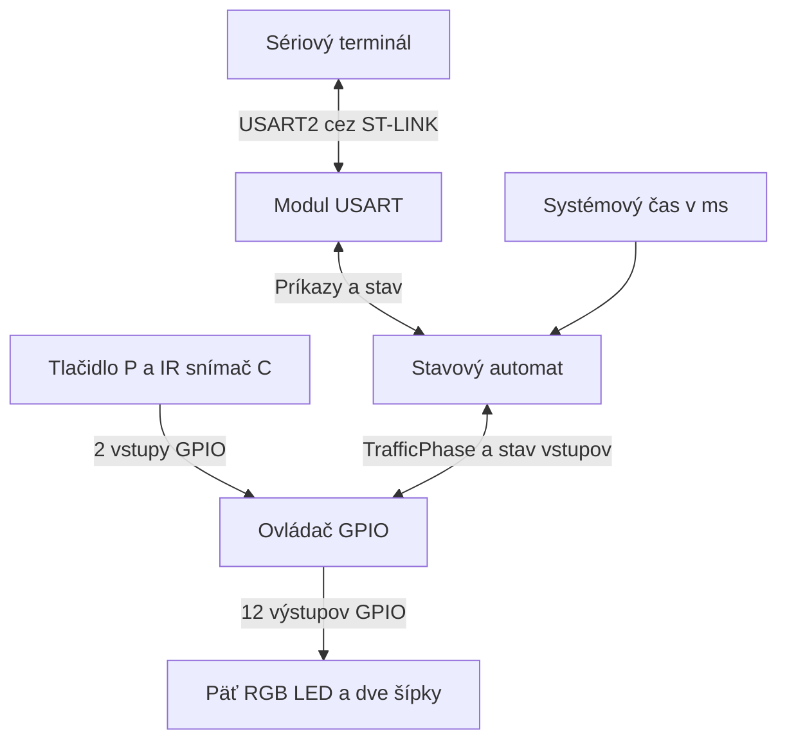
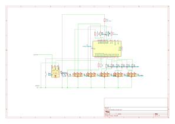

# Model T-križovatky so svetelnou signalizáciou

Tímový projekt z predmetu VRS <sub>· traffic-fsm · model-gpio · usart-control</sub>

**Slovenčina** · [English](EN_README.md)

Značka pri odseku odkazuje na vetvu v [rozdelení práce](#rozdelenie-práce) a určuje, kto text upravuje a udržiava. Pri spoločnej časti sa uvedení správcovia dohodnú na zmene pred odoslaním pull requestu. <sub>· traffic-fsm · model-gpio · usart-control</sub>

## Cieľ a povinný výsledok

Zostavíme model T-križovatky so štyrmi cestnými semaformi, semaforom pre chodcov a dvoma zelenými šípkami. Svetlá pripojíme priamo na 12 výstupov dosky STM32 NUCLEO-F303K8. Na vjazde C bude jeden spoločný pruh pre odbočenie doľava aj doprava a jeden IR snímač pri stopčiare. Chodci si zelenú vyžiadajú tlačidlom. <sub>· traffic-fsm · model-gpio</sub>

Na obhajobe ukážeme cyklus Demo pri voľnom aj obsadenom vjazde C. Predvedieme oba súbehy pri odbočovaní z C a odmeriame trvanie žltej a spoločnej červenej. V režime Control vyskúšame ovládanie z terminálu a odmietnutie kolízneho príkazu. <sub>· traffic-fsm · model-gpio · usart-control</sub>

## Obsah

<sub>traffic-fsm · model-gpio · usart-control</sub>

- [Rozsah projektu](#rozsah-projektu)
- [Prehľad systému](#prehľad-systému)
- [Komunikačný protokol](#komunikačný-protokol)
- [Potrebný hardvér](#potrebný-hardvér)
  - [Schéma zapojenia](#schéma-zapojenia)
- [Orientačný rozpočet](#orientačný-rozpočet)
- [Rozdelenie práce](#rozdelenie-práce)
- [Overenie funkčnosti](#overenie-funkčnosti)
- [Vzdelávacie ciele](#vzdelávacie-ciele)
- [Postup práce v repozitári](#postup-práce-v-repozitári)

## Rozsah projektu

Hlavná cesta vedie v pôdoryse zľava doprava. Na vjazde B sprava je pruh na jazdu rovno a pruh na odbočenie dole. Dolná vetva C má jeden spoločný vjazdový pruh pre obe odbočenia a vedľa neho samostatný výjazdový pruh. Do výjazdového pruhu odbočujú vozidlá z A a B. Pri stopčiare C snímame obsadenosť vjazdu. <sub>· traffic-fsm · model-gpio</sub>

<sub>traffic-fsm · model-gpio</sub>

| Označenie | Príjazd | Čo povoľuje zelená | Farby |
| --- | --- | --- | --- |
| `A` | Zľava | Pokračovať po hlavnej doprava alebo odbočiť dole | Červená, žltá, zelená |
| `A_S` | Zľava | Odbočiť dole pri červenej na `A` | Zelená šípka |
| `B_R` | Sprava | Pokračovať po hlavnej rovno doľava | Červená, žltá, zelená |
| `B_D` | Sprava | Odbočiť dole na vedľajšiu | Červená, žltá, zelená |
| `C` | Spoločný vjazd zdola | Odbočiť doľava z C do A | Červená, žltá, zelená |
| `C_S` | Spoločný vjazd zdola | Odbočiť doprava z C do B pri červenej na `C` | Zelená šípka |
| `P` | Priechod cez dolnú vetvu | Prejsť cez priechod | Červená, zelená |


*Obr. 1 – Dráhy odbočenia, spoločný vjazd C, samostatný výjazd a umiestnenie IR snímača pri stopčiare.* <sub>· model-gpio</sub>

### Pravidlá signalizácie

- Po inicializácii sa rozsvieti päť červených svetiel. Obe šípky sú zhasnuté. Prvá zelená môže začať po jednej sekunde spoločnej červenej. <sub>· traffic-fsm · model-gpio</sub>
- Na každom bežnom semafore svieti v ustálenom stave práve jedna farba. Šípka `A_S` môže svietiť iba pri červenej na `A`. Pravé odbočenie z C je povolené pri rozsvietenej šípke `C_S` a červenej na `C`. Pri zelenej pre chodcov sú všetky štyri cestné semafory na červenej a obe šípky zhasnuté. <sub>· traffic-fsm</sub>
- Automat povolí iba cestné kombinácie uvedené pri Demo a jednotlivé voľby z tabuľky príkazov v Control. Napríklad `A_S` a `B_D` by viedli do toho istého výjazdového pruhu, preto sa zapínajú v rôznych fázach. <sub>· traffic-fsm · usart-control</sub>
- Pri ukončení fázy šípky zhasnú a bežné cestné semafory, ktoré mali zelenú, prejdú naraz na žltú na 2 s. Pri ukončení fázy so samotnou šípkou alebo chodcami sa prejde rovno na spoločnú červenú. Pred každou ďalšou zelenou musí spoločná červená trvať aspoň 1 s. <sub>· traffic-fsm</sub>

### Tlačidlo pre chodcov

Tlačidlo dáme vedľa priechodu P. Zmenu na vstupe potvrdíme po 30 ms stabilného stavu. <sub>· model-gpio</sub>

Pri podržaní tlačidla sa zapíše jedna požiadavka. Automat ju vybaví zapnutím zelenej pre P. Stlačenie počas zelenej pre P patrí do prebiehajúcej fázy. Reset čakajúcu požiadavku vymaže. <sub>· traffic-fsm</sub>

### Režim Demo

Pri zelenej na `A` môže vozidlo odbočiť z A na C cez priechod. Chodci preto dostávajú zelenú vo vlastnej fáze, keď sú cestné semafory na červenej a obe šípky zhasnuté. <sub>· traffic-fsm</sub>

V tabuľke znamená **1** zelenú alebo svietiacu šípku. **0** znamená červenú alebo zhasnutú šípku. Žltá patrí do prechodu medzi fázami. <sub>· traffic-fsm</sub>

<sub>traffic-fsm</sub>

| Fáza | `A` | `A_S` | `B_R` | `B_D` | `C` | `C_S` | `P` |
| --- | ---: | ---: | ---: | ---: | ---: | ---: | ---: |
| A | 1 | 0 | 1 | 0 | 0 | 0 | 0 |
| C doľava | 0 | 1 | 0 | 0 | 1 | 0 | 0 |
| B s odbočením z C doprava | 0 | 0 | 1 | 1 | 0 | 1 | 0 |
| B pri voľnom vjazde C | 0 | 0 | 1 | 1 | 0 | 0 | 0 |
| Chodci | 0 | 0 | 0 | 0 | 0 | 0 | 1 |
| Spoločná červená | 0 | 0 | 0 | 0 | 0 | 0 | 0 |

Po štarte a spoločnej červenej začne fáza A. Po ukončení fázy A a ochrannej sekunde vyhodnotíme filtrovaný vstup `CAR_C`. <sub>· traffic-fsm</sub>

- Pri `CAR_C=0` nasleduje B pri voľnom vjazde C a potom opäť A. <sub>· traffic-fsm</sub>
- Pri `CAR_C=1` nasleduje C doľava, potom B s odbočením z C doprava a nakoniec opäť A. Jeden snímač určuje obsadenosť vjazdu, preto v tomto cykle vyhradíme čas pre obe odbočenia. Ak sa vjazd uvoľní počas prvej fázy C, druhá sa aj tak vykoná. Novú obsadenosť vyhodnotíme po ďalšej fáze A. <sub>· traffic-fsm</sub>

Pri C doľava sa vozidlo z C zaradí do pruhu smerom na A. Šípka `A_S` súčasne pustí vozidlo z A do samostatného výjazdového pruhu na dolnej vetve. Pri B s odbočením z C doprava môže vozidlo z `B_R` ísť rovno doľava, vozidlo z `B_D` do výjazdového pruhu C a vozidlo z `C_S` doprava po hlavnej. Súbehy overíme podľa dráh na obr. 1 aj s modelmi áut. <sub>· traffic-fsm · model-gpio</sub>

Zelená cestnej fázy trvá 5 s. Pri jej ukončení šípky hneď zhasnú a zelené cestné semafory prejdú na žltú na 2 s. Nasleduje aspoň 1 s spoločnej červenej. Keď chodec čaká, po ukončení cestnej fázy a ochrannej sekunde zaradíme P. Chodci majú zelenú 5 s, po nej nasleduje spoločná červená a predtým naplánovaná cestná fáza. <sub>· traffic-fsm</sub>

Automat meria čas od vstupu do fázy podľa systémového času v milisekundách. Hlavná slučka priebežne číta vstupy a spracúva komunikáciu. Žltá a spoločná červená dostanú celý interval aj pri oneskorenej zmene predchádzajúcej fázy. <sub>· traffic-fsm</sub>

### Režim Control a zmena režimu

V Control automat čaká pri spoločnej červenej. Obsluha vyberie bežný semafor, šípku alebo P a príkazom môže zapnúť aj oba semafory B spolu. Zelená trvá do platného príkazu na ukončenie alebo na zmenu režimu. Ďalšia voľba sa vykoná po dobehnutí ochranného intervalu. <sub>· traffic-fsm · usart-control</sub>

V Control ďalej čítame snímač aj tlačidlo. Príkaz `STATUS` ukáže obsadenosť vjazdu C a požiadavku chodcov. Na odbočenie z C doľava použijeme `SET C GREEN`, na odbočenie doprava `SET C_S GREEN`. Požiadavka chodcov sa vybaví pri zapnutí zelenej príkazom `SET P GREEN`. <sub>· traffic-fsm · usart-control</sub>

Pri zmene režimu ukončíme aktívnu fázu podľa rovnakých pravidiel. Rozsvietená cestná žltá dobehne, šípky zhasnú a P prejde na červenú. Cieľový režim sa aktivuje po skončení spoločnej červenej. Ak ochranná sekunda už uplynula, režim sa prepne hneď. Čakajúcu požiadavku chodcov si automat prenesie do nového režimu. Po návrate do Demo začne od fázy A. <sub>· traffic-fsm</sub>

## Prehľad systému

<sub>traffic-fsm · model-gpio · usart-control</sub>



- **Stavový automat** vyberá fázy podľa obsadenosti C a požiadavky chodcov, meria intervaly a overuje príkazy z terminálu. Ovládaču GPIO odovzdá celú fázu typu `TrafficPhase`. <sub>· traffic-fsm</sub>
- **Ovládač GPIO** číta a filtruje tlačidlo a IR snímač. Podľa fázy nastaví červený a zelený kanál každého RGB semafora a stav oboch šípok. <sub>· model-gpio</sub>
- **Modul USART** prijíma bajty cez prerušenie a skladá riadky v hlavnej slučke. Odovzdáva požiadavky automatu a vypisuje farby, šípky, obsadenosť aj čakajúcu požiadavku chodcov. Príjem aj odosielanie prebiehajú bez čakania v hlavnej slučke. <sub>· usart-control</sub>

## Komunikačný protokol

Počítač sa pripojí cez virtuálny sériový port ST-LINK. Použijeme **USART2, 9600 baud, 8 dátových bitov, bez parity, 1 stop bit, bez riadenia toku**. PA2 slúži ako TX a PA15 ako RX. <sub>· usart-control</sub> [STMicroelectronics UM1956, sekcia 7.9](https://www.st.com/resource/en/user_manual/um1956-stm32-nucleo32-boards-mb1180-stmicroelectronics.pdf)

Príkazy sú v ASCII a používajú veľké písmená. Jedna medzera oddeľuje susedné položky. Parameter `<cieľ>` je `A`, `A_S`, `B_R`, `B_D`, `C`, `C_S` alebo `P`. Cieľ `B` zahŕňa oba semafory na vjazde sprava. Prijatý riadok má najviac 32 znakov pred `LF` alebo `CRLF`. Prázdne riadky sa preskočia. Na každý neprázdny riadok zariadenie odpovie jedným riadkom s koncom `CRLF`. Terminál odošle ďalší príkaz po prijatí odpovede. <sub>· usart-control</sub>

<sub>traffic-fsm · usart-control</sub>

| Príkaz | Správanie |
| --- | --- |
| `MODE DEMO` | Vyžiada prechod do Demo. V ustálenom režime Demo potvrdí aktuálny stav. |
| `MODE CONTROL` | Vyžiada prechod do Control. V ustálenom režime Control potvrdí aktuálny stav. |
| `SET <cieľ> GREEN` | Zapne zvolenú zelenú pri `READY=1`. Pre `A_S` a `C_S` tým rozsvieti šípku pri červenej na príslušnom bežnom semafore. Pri `B` zapne obe zelené sprava. Ak už všetky požadované signály svietia nazeleno, potvrdí ich stav. Pri inej aktívnej fáze alebo počas ochranného intervalu vráti `ERR CONFLICT`. |
| `SET <cieľ> YELLOW` | Ukončí aktuálnu zelenú, ak cieľ zahŕňa práve zelený bežný cestný semafor. Na 2 s sa zapne žltá na bežných semaforoch, ktoré v tejto fáze mali zelenú. |
| `SET <cieľ> RED` | Ak cieľ zahŕňa práve zelený signál, ukončí celú aktívnu fázu. Cestná zelená dobehne cez žltú. Šípka zhasne a P prejde priamo na červenú. Pri žltej, červenej alebo zhasnutej šípke príkaz potvrdí aktuálny stav bez zmeny časovania. |
| `STATUS` | Vráti režim, stav prepínania, pripravenosť, farby semaforov, stav šípok, obsadenosť vjazdu C a čakajúcu požiadavku chodcov. |

Príkazy `SET` sa vykonávajú v režime Control po skončení prípadného prepínania. Počas prepínania je dostupný `STATUS`. Opakovanie príkazu na ten istý cieľový režim dostane `OK` a časovanie pokračuje. <sub>· traffic-fsm · usart-control</sub>

<sub>traffic-fsm · usart-control</sub>

| Odpoveď | Význam |
| --- | --- |
| `OK` | Príkaz bol prijatý. Priebeh časovaného prechodu ukáže `STATUS`. |
| `ERR SYNTAX` | Neznámy príkaz, cieľ, režim, farba alebo chybný formát riadka. |
| `ERR LENGTH` | Riadok prekročil 32 znakov. Prijímač zahodí zvyšok po koniec riadka a potom prijíma ďalší príkaz. |
| `ERR BUSY` | Počas prepínania prišiel `SET` alebo požiadavka na návrat do práve opúšťaného režimu. |
| `ERR MODE` | Používateľ poslal `SET` v režime Demo. |
| `ERR STATE` | Príkaz na žltú sa netýka žiadneho práve zeleného bežného cestného semafora. |
| `ERR CONFLICT` | Novú zelenú sme vyžiadali pri aktívnej fáze, žltej alebo počas ochrannej červenej. |

Príklad odpovede na `STATUS` v Control pri aute pred stopčiarou C a čakajúcom chodcovi <sub>· usart-control</sub>

```text
OK MODE=CONTROL NEXT=- READY=1 A=RED A_S=OFF B_R=RED B_D=RED C=RED C_S=OFF P=RED CAR_C=1 P_REQ=1
```

`NEXT` obsahuje cieľový režim pri prepínaní alebo `-` mimo neho. `READY=1` znamená, že Control môže prijať novú zelenú. Šípky sa vypisujú ako `ON` alebo `OFF`. `CAR_C=1` znamená obsadený vjazd a `CAR_C=0` voľný vjazd. `P_REQ=1` označuje čakajúcu požiadavku chodcov. Po zapnutí zelenej pre P má `P_REQ` hodnotu `0`. <sub>· traffic-fsm · usart-control</sub>

## Potrebný hardvér

<sub>model-gpio</sub>

| Položka | Počet | Použitie |
| --- | ---: | --- |
| STM32 NUCLEO-F303K8 | 1 | Riadenie, programovanie a sériová komunikácia cez ST-LINK |
| Difúzna RGB LED 5 mm so spoločnou katódou | 5 | `A`, `B_R`, `B_D`, `C` a `P` |
| Zelená LED 5 mm | 2 | Šípky `A_S` a `C_S` |
| Rezistor 330 Ω, ¼ W | 12 | Po jednom pre každý červený a zelený kanál RGB LED a každú zelenú šípku |
| Spínacie tlačidlo (NO) | 1 | Požiadavka pri priechode P |
| Reflexný IR modul s LM393 a digitálnym výstupom (typ FC-51) | 1 | Detekcia auta stojaceho pri stopčiare C |
| Kontaktné pole, 830 bodov | 1 | Osadenie dosky a skúšobné zapojenie |
| Prepojovacie vodiče M–M | 1 balenie (40 ks) | Zapojenie na kontaktnom poli |
| Prepojka M–F, 3 vodiče | 1 | Pripojenie snímača pri vozovke ku kontaktnému poľu |
| Model auta alebo maketa | 2 až 3 | Skúška snímania a súbežných prejazdov |
| Podložka a materiál na model | 1 súprava | Vozovka, priechod a uchytenie svetiel a snímača |
| Počítač a USB dátový kábel Mini-B | 1 súprava | Napájanie z USB, nahratie programu a terminál |

### Schéma zapojenia

<sub>model-gpio</sub>



Pracovná schéma z KiCadu používa symbol mikrokontroléra STM32F303K8Tx, 12 rezistorov po 330 Ω a symbol IR prijímača TSSP58038. Na prototype s doskou NUCLEO-F303K8 použijeme modul FC-51, ktorý pripojíme podľa tabuľky vstupov nižšie. <sub>· model-gpio</sub>

### Zapojenie LED

Spoločnú katódu každej RGB LED pripojíme na GND. Anódu červeného a zeleného kanála pripojíme na samostatné výstupy GPIO, každú cez vlastný rezistor. Modrý vývod necháme nezapojený. Na cestnom semafore vznikne žltá súčasným rozsvietením červeného a zeleného kanála. Pre chodcov použijeme iba červenú a zelenú. <sub>· model-gpio</sub>

<sub>model-gpio</sub>

| Farba na semafore | Červený kanál R | Zelený kanál G |
| --- | ---: | ---: |
| Červená | 1 | 0 |
| Žltá (iba cestné semafory) | 1 | 1 |
| Zelená | 0 | 1 |

Použijeme 12 rovnakých sériových rezistorov po 330 Ω. Najprv na jednej RGB LED pripojenej na 3,3 V výstupy dosky skontrolujeme jas červenej a zelenej aj odtieň žltej pri súčasnom rozsvietení oboch kanálov. Zelený kanál má vyššie priepustné napätie, preto pri rovnakom odpore môže svietiť slabšie. <sub>· model-gpio</sub> [Parametre RGB LED](https://techfun.sk/produkt/led-rgb-5-mm/) · [Datasheet STM32F303x6/x8, charakteristiky GPIO](https://www.st.com/resource/en/datasheet/stm32f303k8.pdf)

<sub>model-gpio</sub>

| Svetlo | Potlač na doske | Pin STM32 | Konektor | Sériový rezistor |
| --- | --- | --- | --- | ---: |
| `A` R | A0 | PA0 | CN4/12 | 330 Ω |
| `A` G | A1 | PA1 | CN4/11 | 330 Ω |
| `B_R` R | A2 | PA3 | CN4/10 | 330 Ω |
| `B_R` G | A3 | PA4 | CN4/9 | 330 Ω |
| `B_D` R | A6 | PA7 | CN4/6 | 330 Ω |
| `B_D` G | D9 | PA8 | CN3/12 | 330 Ω |
| `C` R | D3 | PB0 | CN3/6 | 330 Ω |
| `C` G | D6 | PB1 | CN3/9 | 330 Ω |
| `P` R | D11 | PB5 | CN3/14 | 330 Ω |
| `P` G | D12 | PB4 | CN3/15 | 330 Ω |
| `A_S` zelená | D10 | PA11 | CN3/13 | 330 Ω |
| `C_S` zelená | D13 | PB3 | CN4/15 | 330 Ω |

Pri zapnutí `C_S` sa rozsvieti aj používateľská LED LD3 na doske, pretože používa ten istý pin D13. <sub>· model-gpio</sub> [STMicroelectronics UM1956, sekcie 6.4 a 7.11](https://www.st.com/resource/en/user_manual/um1956-stm32-nucleo32-boards-mb1180-stmicroelectronics.pdf)

### Zapojenie tlačidla a IR snímača

Tlačidlo zapojíme medzi `P_BTN` a GND. Reflexný IR modul upevníme z boku vjazdu C tak, aby snímal auto tesne pred stopčiarou. Citlivosť nastavíme potenciometrom na dosah potrebný pre jeden pruh. Overíme, či snímač zachytí stojace auto a či pri prejazde v susednom výjazdovom pruhu ostane vstup vo voľnom stave. <sub>· model-gpio</sub> [Parametre modulu](https://techfun.sk/produkt/infracerveny-senzor-pre-vyhybanie-sa-prekazkam/)

Na module pripojíme `VCC` na `+3V3` (CN4/14), `GND` na spoločnú zem a `OUT` na D2. Pri detekcii očakávame na `OUT` logickú nulu. Po 30 ms stabilnej úrovne sa stav preloží do `CAR_C=1` pre obsadený vjazd alebo `CAR_C=0` pre voľný. Pri prvom zapojení polaritu a dosah overíme s autami, ktoré použijeme na modeli. <sub>· model-gpio</sub> [Zapojenie a polarita FC-51](https://flashready.in/components/ir-obstacle-sensor)

<sub>model-gpio</sub>

| Vstup | Potlač na doske | Pin STM32 | Konektor | Nastavenie v CubeMX |
| --- | --- | --- | --- | --- |
| Tlačidlo `P_BTN` | D0 | PA10 | CN3/2 | `GPIO_Input`, pull-up |
| Výstup `OUT` snímača `CAR_C` | D2 | PA12 | CN3/5 | `GPIO_Input`, pull-up |

Pin D1 (PA9) je voľný. <sub>· model-gpio</sub>

V CubeMX nastavíme 12 výstupov ako `GPIO_Output`, `Push Pull`, `Low Speed` a `No pull-up and no pull-down`. Počiatočná úroveň piatich červených výstupov bude `High`. Zelené výstupy a šípky začnú na `Low`. Obe zložky farby daného semafora sú na jednom porte GPIO a pri zmene ich nastavíme jedným zápisom do `BSRR`. Pri ladení použijeme `Serial Wire`, aby boli PB3 a PB4 k dispozícii ako GPIO. USART2 ostáva na PA2 a PA15. <sub>· model-gpio · usart-control</sub> [STMicroelectronics UM1956, tabuľka 12](https://www.st.com/resource/en/user_manual/um1956-stm32-nucleo32-boards-mb1180-stmicroelectronics.pdf)

## Orientačný rozpočet

Rozpočet vychádza z cien Techfun k 12. 11. 2026 vrátane DPH. Zahŕňa diely na jeden model bez dosky NUCLEO, áut a materiálu na maketu. <sub>· model-gpio</sub>

<sub>model-gpio</sub>

| Položka | Objednáme | Cena spolu |
| --- | ---: | ---: |
| [RGB LED 5 mm, difúzna, spoločná katóda](https://techfun.sk/produkt/led-rgb-5-mm/) | 5 ks | 0,75 € |
| [Zelená LED 5 mm](https://techfun.sk/produkt/led-ka-1-kus-5mm-rozne-farby/) | 2 ks | 0,06 € |
| [Rezistory 330 Ω, ¼ W](https://techfun.sk/produkt/rezistor-rozne-hodnoty-1-4w-10-kusov/) | 1 balenie (20 ks) | 0,25 € |
| [Tlačidlo s násadou](https://techfun.sk/produkt/tlacidlo-s-nasadou/) | 1 ks | 0,15 € |
| [Reflexný IR modul s LM393](https://techfun.sk/produkt/infracerveny-senzor-pre-vyhybanie-sa-prekazkam/) | 1 ks | 0,65 € |
| [Nepájivé pole, 830 bodov](https://techfun.sk/produkt/nepajive-pole-830-bodov/) | 1 ks | 1,60 € |
| [Prepojky 20 cm, variant M–M](https://techfun.sk/produkt/kabliky-40-kusov-20-cm/) | 1 balenie (40 ks) | 2,20 € |
| [Káblik k snímaču, variant 3 piny M–F](https://techfun.sk/produkt/kablik-70cm-2piny-3piny-4piny/) | 1 ks | do 0,85 € |
| **Diely spolu** | | **do 6,51 €** |
| [Doručenie GLS ParcelShop](https://techfun.sk/sposob-platby-a-dorucenia/) | 1 zásielka | 2,75 € |
| **Spolu s dopravou** | | **do 9,26 €** |

Pri kábliku používame hornú hranicu ceny zverejneného rozpätia. Ak už máme tri M–F vodiče, použijeme ich na snímač a rozpočet s dopravou bude 8,41 €. USB Mini-B dátový kábel stojí od 0,70 € podľa dĺžky. <sub>· model-gpio</sub> [Ponuka kábla](https://techfun.sk/produkt/usb-na-mini-usb-kabel-rozne-dlzky/)

## Rozdelenie práce

Každý člen navrhne, naprogramuje a overí vlastný modul. K modulu odovzdá zdrojové súbory a výsledky troch uvedených skúšok. Pri obhajobe svoju časť predvedie na spoločnom modeli. <sub>· traffic-fsm · model-gpio · usart-control</sub>

<sub>traffic-fsm · model-gpio · usart-control</sub>

| Člen a vetva | Návrh a implementácia | Samostatný výstup a obhajoba |
| --- | --- | --- |
| **Branislav Krajčovič** · `feature/traffic-fsm` | V `traffic_fsm.c/.h` pripraví kombinácie fáz, zaradenie oboch odbočení pri obsadenom vjazde C, ukončenie zelenej a ochranné intervaly. Doplní vybavenie požiadavky chodcov a spracovanie príkazov v Control. | Tabuľka prechodov, kód automatu a skúšky F1–F3. Predvedie oba súbehy pri odbočení z C a odmietnutie kolíznej požiadavky. |
| **Miroslav Kučera** · `feature/model-gpio` | Zhotoví model a zapojí päť RGB LED, dve šípky, tlačidlo a jeden IR snímač na C. Nakonfiguruje GPIO v CubeMX. V `traffic_gpio.c/.h` naprogramuje mapovanie farieb, nastavenie GPIO, inicializáciu a filtrovanie vstupov. | Model, schéma zapojenia, kód ovládača a skúšky H1–H3. Predvedie obe šípky, samostatné semafory B a detekciu auta pri stopčiare C. |
| **Samuel Jantošovič** · `feature/usart-control` | Navrhne formát protokolu a konfiguráciu USART2. V `traffic_serial.c/.h` naprogramuje príjem a odosielanie cez prerušenia, skladanie riadkov, overenie cieľov a výpis svetiel, šípok aj vstupov. | Popis protokolu, kód komunikácie a skúšky U1–U3 so záznamom z terminálu. Predvedie ručné ovládanie a spracovanie chybného vstupu. |

## Overenie funkčnosti

| Skúška | Postup a očakávaný výsledok | Správca |
| --- | --- | --- |
| **F1 – Obsluha vjazdu C** | Pri voľnom vjazde overíme A → B → A. S autom pred stopčiarou overíme A → C doľava → B s odbočením z C doprava → A. Auto odoberieme počas C doľava a skontrolujeme, že plánovaná fáza s `C_S` prebehne. | <sub>traffic-fsm</sub> |
| **F2 – Šípky, kolízie a chodci** | Overíme dvojicu `C` a `A_S` aj trojicu `B_R`, `B_D` a `C_S`. Počas zelenej A stlačíme tlačidlo. P dostane zelenú až po žltej a spoločnej červenej a všetky cestné pohyby ostanú zakázané. V Control pri zelenej `B_D` pošleme `SET A_S GREEN` a očakávame `ERR CONFLICT`. | <sub>traffic-fsm</sub> |
| **F3 – Prepnutie režimu** | Počas B s odbočením z C doprava stlačíme tlačidlo a prepneme do Control. Overíme zhasnutie `C_S`, žltú na oboch B, spoločnú červenú a `P_REQ=1` vo výpise. Zapneme P a počas zelenej vyžiadame Demo. Po ochrannej sekunde sa má spustiť A. | <sub>traffic-fsm</sub> |
| **H1 – Mapa LED** | Na stole zapneme postupne 12 výstupov, vždy jeden. Overíme priradenie kanálov a šípok. Na každom cestnom semafore zapneme R aj G a skontrolujeme, či sa žltá dá odlíšiť od červenej a zelenej. | <sub>model-gpio</sub> |
| **H2 – Inicializácia a prechod** | Resetujeme dosku počas aktívnej fázy a skontrolujeme, či prvý rozsvietený stav tvorí päť červených. Pri zmene fázy overíme žltú a spoločnú červenú pred rozsvietením ďalších zelených. | <sub>model-gpio</sub> |
| **H3 – Čítanie vstupov** | Postavíme auto pred stopčiaru C, overíme `CAR_C=1` počas státia a `CAR_C=0` po odchode. Prejazd po výjazdovom pruhu má ponechať `CAR_C=0`. Pri podržaní tlačidla sa zaznamená jedno stlačenie, ďalšie až po uvoľnení a novom stlačení. | <sub>model-gpio</sub> |
| **U1 – Ovládanie a výpis stavu** | Po `READY=1` skúsime `SET B_R GREEN`, `SET B_D GREEN`, `SET C GREEN` a `SET C_S GREEN`. Pred každým novým povolením ukončíme predchádzajúcu fázu a počkáme na `READY=1`. Pri `STATUS` s `LF` aj `CRLF` overíme hodnoty `CAR_C` a `P_REQ`. | <sub>usart-control</sub> |
| **U2 – Chybný vstup a obnova príjmu** | V Control pošleme `SET X GREEN`, `SET A_S YELLOW` a riadok s 33 znakmi. Očakávame `ERR SYNTAX`, `ERR STATE` a `ERR LENGTH`. Nasledujúci `STATUS` sa spracuje normálne. | <sub>usart-control</sub> |
| **U3 – Príkazy počas behu** | V Demo pošleme `SET A RED` a overíme `ERR MODE`. Počas zelenej pošleme `MODE CONTROL` a hneď po `OK` príkaz `SET P GREEN`. Počas prepínania má prísť `ERR BUSY`. | <sub>usart-control</sub> |

### Spoločná skúška na hotovom modeli

1. Po resete skontrolujeme spoločnú červenú a cyklus A → B pri voľnom C. Pristavením auta na C vyvoláme obe fázy s odbočením z C. Povolené pohyby prejdeme s modelmi áut po vyznačených dráhach a skontrolujeme odstupy. Z videa určíme trvanie zelenej, žltej a spoločnej červenej. <sub>· traffic-fsm · model-gpio</sub>
2. Počas B s odbočením z C doprava stlačíme tlačidlo. Po zhasnutí `C_S`, žltej na oboch B a spoločnej červenej dostane P zelenú. Overíme, že všetky cestné semafory svietia načerveno, obe šípky sú zhasnuté a po ukončení P sa pokračuje fázou A. <sub>· traffic-fsm · model-gpio</sub>
3. V Control po `READY=1` zadáme `SET A_S GREEN`. Na A má svietiť červená spolu so šípkou. Príkaz `SET B_D GREEN` musí vrátiť `ERR CONFLICT`. Po `SET A_S RED` a skončení spoločnej červenej zopakujeme príkaz pre `B_D` a overíme `OK` aj stav na modeli. <sub>· traffic-fsm · usart-control</sub>

K vyhodnoteniu priložíme namerané časy a záznam z terminálu s príkazmi a odpoveďami. <sub>· traffic-fsm · model-gpio · usart-control</sub>

## Vzdelávacie ciele

- Nakonfigurovať GPIO v STM32CubeMX, čítať IR snímač a odfiltrovať zákmity tlačidla. <sub>· model-gpio</sub>
- Zapájať RGB LED so spoločnou katódou a overiť mapu výstupov podľa výsledných farieb. <sub>· model-gpio</sub>
- Navrhnúť stavový automat s neblokujúcim časovaním a otestovať povolené prechody. <sub>· traffic-fsm</sub>
- Prijímať a odosielať dáta cez USART pomocou prerušení a spracovať platné aj chybné príkazy. <sub>· usart-control</sub>
- Dohodnúť rozhrania medzi modulmi v C a overiť ich spoluprácu na spoločnom modeli. <sub>· traffic-fsm · model-gpio · usart-control</sub>

## Postup práce v repozitári

1. Na vetve `main` pripravíme spoločný projekt v STM32CubeIDE, mapu pinov, typy pre rozhrania a súbor `README.md`. Konfiguráciu `.ioc` zapracuje Miroslav po dohode s Branislavom a Samuelom. <sub>· traffic-fsm · model-gpio · usart-control</sub>
2. Každý člen vyvinie a odskúša svoj modul vo vlastnej vetve. Do `main` sa zmeny dostanú po kontrole kolegom cez pull request. <sub>· traffic-fsm · model-gpio · usart-control</sub>
3. Po spojení modulov overíme ich spoluprácu podľa [spoločnej skúšky na hotovom modeli](#spoločná-skúška-na-hotovom-modeli). <sub>· traffic-fsm · model-gpio · usart-control</sub>
4. Pred obhajobou zostavíme projekt z `main`, nahráme ho cez ST-LINK a vykonáme skúšky na hotovom modeli. Výsledky zaznamenáme spolu s mapou zapojenia a ukážkou komunikácie. <sub>· traffic-fsm · model-gpio · usart-control</sub>
